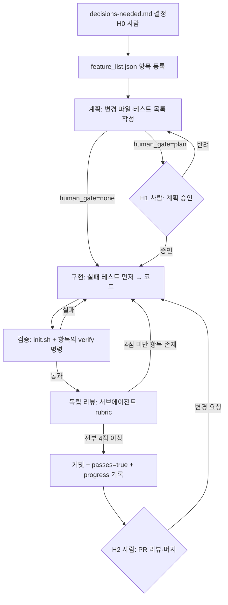

# AI 작업 흐름 제안 (ai-workflow)

> 상태: **제안 — 미확정**. 결정 항목은 [decisions-needed.md](./decisions-needed.md) D3·D5·D12.
> 이 문서는 "이 저장소에서 Claude Code 같은 코딩 에이전트에게 일을 맡기는 방법" 을 정한다. 외부 근거는 [research.md §8](./research.md#8-ai-코딩-에이전트-장시간-작업).
> 전제: architecture-proposal.md 추천안 B (모듈 경계). A 를 고르면 "모듈" 을 "기능 패키지" 로 읽으면 된다.

---

## 0. 지금 바로 AI 루프를 돌릴 수 없는 이유 (선행 조건)

에이전트 루프는 **기계가 판정하는 pass/fail 신호**가 있어야 스스로 닫힌다 ([F] https://code.claude.com/docs/en/best-practices — "Give Claude a way to verify its work"). 현재 이 저장소의 신호 상태:

| 신호 | 현재 | 문제 | 해결 항목 |
|---|---|---|---|
| `./gradlew test` | 테스트 1개, **실 PostgreSQL 필요** | DB 없는 환경에서 항상 실패 → 에이전트가 "원래 깨져 있음" 과 "내가 깨뜨림" 을 구분 못 함 | conventions-proposal.md §6.4 (D3) |
| 기능 테스트 | 0개 | F1(채점 API 항상 500)이 잠복한 이유 | feature_list `TEST-*` 항목 |
| 아키텍처 규칙 | ArchUnit 7개 규칙 — 위반 규칙은 `@Disabled` | 규칙을 고치는 작업이 끝날 때마다 `@Disabled` 를 풀어야 신호가 됨 | §4.2 의 `ARCH-*` 항목 |
| 포맷 | Spotless 추가됨, `enforceCheck = false` | 기존 코드 미포맷 → 지금 켜면 항상 실패 | D5 |

→ **첫 루프의 첫 항목들은 "신호 만들기"** 다 (§4.2 `SIG-*`). 이게 끝나기 전에는 기능 작업을 장시간 루프로 돌리지 않는다.

---

## 1. 작업 단위 설정

### 1.1 단위의 정의

**작업 단위 1개 = `feature_list.json` 항목 1개 = 커밋 1~3개 = PR 1개 (또는 PR 안의 1 커밋 묶음)**

| 기준 | 규칙 | 이 저장소 예 |
|---|---|---|
| 검증 가능 | 항목마다 **통과해야 할 명령과 테스트 이름**을 미리 적는다 | `FIX-F1`: `./gradlew test --tests '*SimilarityClientTest'` |
| 범위 | **모듈 1개** 안에서 끝난다. 모듈 2개를 건드리면 쪼갠다 (예외: 모듈 경계 이동 자체가 목적인 `ARCH-*`) | `FIX-F2` 는 `common` + `resources` 만 |
| 크기 | `src/main` 변경 파일 **5개 이하** (estimated — 사람이 한 번에 리뷰 가능한 크기). 넘으면 쪼갠다 | `ARCH-B2`(similarity 모듈 이동)는 7파일 → `git mv` 커밋과 코드 수정 커밋으로 분리 |
| 독립성 | 다른 항목이 끝나지 않아도 시작 가능하거나, `depends_on` 을 명시 | `ARCH-B3` depends_on `ARCH-B2` |
| 계약 | 외부 API 응답(03 명세)을 바꾸는 항목은 `human_gate: "plan"` | `FIX-F3` (500 → 400 으로 응답 변경) |

### 1.2 단위로 만들면 안 되는 것

| 안 됨 | 이유 | 대신 |
|---|---|---|
| "예외 처리 개선" | 완료 판정 불가 | "깨진 JSON 이 400 `BAD_REQUEST` 를 반환한다" + 테스트 이름 |
| "sentence 리팩터링" | 범위 무한 | R5 위반 1건 해소 = 항목 1개 |
| 결정이 안 된 항목 (D1 미결 상태의 `ARCH-B*`) | 되돌림 비용 | decisions-needed.md 결정 후 등록 |

---

## 2. 계획 → 구현 → 리뷰 흐름과 사람 확인 지점



### 2.1 단계별 산출물

| 단계 | 에이전트가 남기는 것 | 위치 |
|---|---|---|
| 계획 | 변경 예정 파일 목록, 추가할 테스트 이름, 영향받는 문서(05/06/03) | `claude-progress.md` 의 해당 항목 블록 |
| 구현 | **실패하는 테스트 커밋 → 수정 커밋** 순서 (conventions-proposal.md §6.1 T2) | git |
| 검증 | 실행한 명령과 출력 요약 (성공 주장 대신 증거 — [F] https://code.claude.com/docs/en/best-practices) | `claude-progress.md` |
| 리뷰 | rubric 점수 + 지적 사항 | `docs/ai/reviews/<항목ID>-round-<N>.md` |

### 2.2 사람 확인 지점 (H0~H3)

| ID | 시점 | 사람이 보는 것 | 소요 (estimated) | 건너뛰면 |
|---|---|---|---|---|
| **H0** | 루프 시작 전 | decisions-needed.md 결정, feature_list 항목 승인 | 30분 | 에이전트가 미결 사항을 임의 결정 |
| **H1** | `human_gate: "plan"` 항목의 구현 전 | 변경 파일 목록, 외부 계약 변경 여부 | 항목당 5분 | 되돌리기 비싼 변경(API 응답·패키지 이동)이 리뷰 없이 진행 |
| **H2** | PR 머지 | diff, 리뷰 파일, 테스트 출력 | PR당 10~20분 | — (생략 불가) |
| **H3** | 에이전트가 `blocked` 표시 시 | blockers.md 의 원인·시도 내역 | 수시 | 루프가 같은 실패를 반복 |

`human_gate` 기본값 규칙:

| 조건 | gate |
|---|---|
| 외부 API 응답(상태 코드·body) 변경 | `plan` |
| 패키지 이동 (`git mv`) | `plan` |
| `build.gradle` 의존성 추가 | `plan` |
| 05/06/03 문서 수정 | `plan` |
| 그 외 (테스트 추가, 모듈 내부 수정) | `none` (H2 에서만 확인) |

### 2.3 독립 리뷰 (이 작업에서 쓴 방식)

- 구현한 에이전트와 **다른 서브에이전트**를 새로 띄워 "승인 전에 반드시 문제를 찾는 시니어 Spring 엔지니어" 역할로 리뷰시킨다. 컨텍스트를 공유하지 않아야 자기 확증을 피한다.
- rubric 4개(근거성·구체성·일관성·판단 가능성) 각 1~5점, **모두 4점 이상 + 최소 2라운드** 를 통과 조건으로 한다 (이 문서 세트가 같은 기준으로 만들어졌다 — [reviews/](./reviews/)).
- 코드 항목에는 rubric 에 "테스트가 실패 → 통과로 바뀌는 것을 직접 실행해 확인했는가" 를 리뷰어 지시에 추가한다.
- 실제 효과: 이 문서 세트의 1라운드 리뷰가 작성자가 놓친 **실행 가능한 결함**(OSIV 커넥션 점유, `RestClient.Builder` 빈 부재 등)을 리뷰어의 프로브 실행으로 찾아냈다 ([reviews/current-state-round-1.md](./reviews/current-state-round-1.md) C1, M2).

---

## 3. 리뷰 체크리스트 (H2 와 서브에이전트 리뷰 공통)

| # | 확인 | 기계 검증 |
|---|---|---|
| 1 | 항목의 `verify` 명령이 통과하고, 출력이 progress 에 있다 | ✓ (init.sh) |
| 2 | 수정 전 실패하던 테스트가 있다 (버그 수정 항목) | git log 로 확인 |
| 3 | 다른 모듈의 하위 패키지를 import 하지 않았다 | ✓ ArchUnit R2 |
| 4 | 서비스 public 메서드가 엔티티를 반환하지 않는다 | ✓ ArchUnit R5 |
| 5 | 같은 클래스에서 `@Transactional` 메서드를 호출하지 않는다 | ✓ ArchUnit R6 |
| 6 | 외부 호출이 `@Transactional` 메서드 안에 없다 | 사람/리뷰어 (estimated — 기계 검증 규칙 미작성) |
| 7 | throw 직전에 로그를 남기지 않았다 (스케줄러 진입점 제외) | 사람/리뷰어 |
| 8 | 로그 메시지 형식 `"{대상} {동작}: key=value"`, 토큰·시크릿 없음 | 사람/리뷰어 |
| 9 | 외부 계약(03) 변경이 있으면 03 문서도 같은 PR 에서 수정 | 사람 |
| 10 | `src/main` 변경 파일 ≤ 5 | ✓ `git diff --stat` |

---

## 4. `feature_list.json` 기반 장시간 루프

근거: Anthropic, "Effective harnesses for long-running agents" (2025-11-26) — initializer 세션 + coding 세션, `feature_list.json` 의 `passes` 만 수정, 한 번에 기능 1개, `init.sh` 로 기동·기본 검증, 진행 파일 + git 으로 세션 간 기억 유지. [F] https://www.anthropic.com/engineering/effective-harnesses-for-long-running-agents

### 4.1 파일 구성

| 파일 | 역할 | 수정 권한 |
|---|---|---|
| `docs/ai/feature_list.json` | 작업 항목과 완료 여부 | 사람: 항목 추가·삭제·수정. 에이전트: **`passes`, `blocked` 필드만** |
| `docs/ai/claude-progress.md` | 세션별 진행 로그 (append-only) | 에이전트 |
| `scripts/init.sh` | 기동 + 기본 검증 1-커맨드 (§4.3) | 사람 (승인 후 추가 — `src/` 밖이지만 이번 작업 범위 밖이라 미생성) |
| `.claude/hooks/check-done.sh` | Stop hook 게이트 (이미 존재 — 이 작업의 `checklist.json` 용) | 사람 |
| `CLAUDE.md` | 세션 시작 시 자동 로드되는 규칙 요약 | 사람 승인 |

- 예시 파일: [`feature_list.example.json`](./feature_list.example.json) — 아래 §4.2 항목을 실제 형식으로 담았다.
- JSON 을 쓰는 이유: Markdown 보다 모델이 부적절하게 수정·덮어쓸 가능성이 낮았다는 위 글의 관찰 [F].

### 4.2 항목 스키마와 이 저장소의 첫 항목들

```json
{
  "id": "FIX-F1",
  "title": "SimilarityClient.score 에 @RequestBody 추가 — 채점 API 500 해소",
  "module": "infra.similarity",
  "depends_on": ["TEST-1"],
  "human_gate": "none",
  "verify": [
    "bash ./gradlew test --tests '*SimilarityClientTest'",
    "bash ./gradlew test --tests '*ArchitectureTest*'"
  ],
  "acceptance": "SimilarityClientTest @Disabled 해제 후 통과, ArchUnit R7 @Disabled 해제 후 통과",
  "evidence": "current-state.md F1, §7.2 P7",
  "passes": false,
  "blocked": null
}
```

| 순서 | id | 내용 | gate | 근거 |
|---|---|---|---|---|
| 1 | `SIG-1` | `CoreApplicationTests` 를 `integration` 태그로 분리, `./gradlew test` 가 DB 없이 통과 | plan | conventions §6.4, D3 |
| 2 | `SIG-2` | `spotlessApply` 단독 커밋 + `enforceCheck = true` | plan | D5 |
| 3 | `TEST-1` | `GradeTest`, `SimilarityClientTest`, `SentenceControllerTest`, `AnswerControllerTest` 추가 (현재 실패하는 것은 `@Disabled("FIX-F*")` 로) | none | conventions §6.3 |
| 4 | `FIX-F1` | `@RequestBody` | none | F1 |
| 5 | `FIX-F2` | `spring.messages.basename` + `fallback-to-system-locale` | none | F2 |
| 6 | `FIX-F3` | `GlobalExceptionHandler extends ResponseEntityExceptionHandler`, `BaseException` 로그 레벨 | **plan** (응답 변경) | F3 |
| 7 | `FIX-F4` | self-invocation 제거 + `open-in-view=false` | plan | F4, D4 |
| 8 | `ARCH-A1` | Similarity 빈 설정을 `common` 밖으로 (R3·R1 통과) | none | arch §4.3 단계 1 |
| 9 | `ARCH-B2` | `infra.similarity` → `similarity` 모듈 + `SimilarityScorer` | **plan** (패키지 이동) | arch §4.3 단계 2, D1 결정 후 |
| 10 | `ARCH-B3` | `SentenceReader`/`SentenceDetail` 도입, `answer` 의존 정리 (R2·R5 통과) | plan | 위와 동일 |
| 11 | `DOC-1` | 05/06/99/03 수정 목록 반영 | plan | conventions §8 |

### 4.3 `init.sh` (제안 — 파일은 승인 후 추가)

```bash
#!/usr/bin/env bash
# 세션 시작 시 1회: 환경 확인 + 기본 신호
set -euo pipefail
cd "$(dirname "$0")/.."
java -version 2>&1 | head -1
bash ./gradlew --version | grep Gradle
bash ./gradlew test --console=plain        # SIG-1 이후 DB 없이 통과해야 함
bash ./gradlew spotlessCheck --console=plain || echo "spotless: 위반 있음 (SIG-2 전에는 정보용)"
git log --oneline -10
```

- `bash ./gradlew` 를 쓰는 이유: `gradlew` 가 git 에 실행 권한 없이 저장됨 (blockers.md §2 #1, D11).
- 통합 테스트(`integrationTest`)는 Docker 가 있는 환경에서만 — init.sh 에 넣지 않는다.

### 4.4 세션 루틴

**시작 (매 세션)**

1. `pwd` → `docs/ai/claude-progress.md` 마지막 블록 읽기 → `docs/ai/feature_list.json` 읽기 → `git log --oneline -20`
2. `scripts/init.sh` 실행. **실패하면 새 항목을 시작하지 않고** 깨진 원인부터 (직전 세션이 남긴 문제일 가능성)
3. `passes: false` 이고 `blocked: null` 이며 `depends_on` 이 모두 `passes: true` 인 항목 중 **배열 순서상 첫 번째 1개**를 고른다

**진행**

4. 계획을 progress 에 기록 → `human_gate: "plan"` 이면 여기서 멈추고 사람에게 요청 (H1)
5. 실패 테스트 커밋 → 구현 커밋 → `verify` 명령 실행 → 출력 요약을 progress 에
6. 서브에이전트 리뷰 (§2.3) → 반영

**종료**

7. `passes: true` 로 바꾸고 커밋. 실패로 끝나면 `blocked: "<원인 한 줄>"` + blockers.md 에 상세
8. progress 에 "다음 세션이 알아야 할 것" 3줄 이내

### 4.5 루프 운영 규칙

| 규칙 | 이유 |
|---|---|
| 한 세션 = 한 항목. 끝나면 다음 항목은 **새 세션** | 컨텍스트 오염 방지, 위 Anthropic 글의 "한 번에 기능 1개" [F] |
| 에이전트는 항목의 `verify`·`acceptance` 를 고치지 않는다 | 기준을 낮춰 통과시키는 것 방지 — 위 글: "It is unacceptable to remove or edit tests…" [F] |
| 테스트를 `@Disabled` 로 바꾸는 것은 `blocked` 와 함께만 | 같은 이유 |
| 같은 항목이 2세션 연속 실패하면 `blocked` 로 두고 다음 항목으로 | 무한 재시도 방지 |
| `blocked` 3개 이상이면 루프 중단 → H3 | 구조적 문제 신호 |
| 30분 이상 환경 문제 → blockers.md 기록 후 분석 가능한 범위까지 | 이 작업의 TASK.md 규칙과 동일 |

### 4.6 Stop hook 게이트

이 저장소는 이미 `.claude/hooks/check-done.sh` 가 `checklist.json` 의 미완료 항목이 있으면 종료를 막는다 (`exit 2`). 같은 패턴으로 feature_list 루프용 게이트를 만들 수 있다.

```bash
# 제안: .claude/hooks/check-feature.sh — 현재 항목이 검증 없이 passes=true 가 되는 것을 막음
f=docs/ai/feature_list.json
[ -f "$f" ] || exit 0
# 마지막 커밋에서 passes 가 true 로 바뀐 항목이 있으면, progress 에 그 id 의 verify 출력이 있어야 함
changed=$(git diff HEAD~1 -- "$f" | grep -c '"passes": true' || true)
if [ "$changed" -gt 0 ] && ! grep -q "verify:" docs/ai/claude-progress.md; then
  echo "passes=true 로 바꿨지만 progress 에 verify 출력 기록이 없음. 검증 후 기록할 것." >&2
  exit 2
fi
exit 0
```

- 무한 루프 방지 카운터는 기존 `check-done.sh` 의 방식(15회)을 따른다.
- hook 형식은 기존 `.claude/settings.json` 과 같음. Stop hook 의 `exit 2` 동작은 기존 hook 이 이 세션에서 실제로 쓰였다는 사실에 근거 (공식 문서 본문 미확인 — research.md §9 의 docs 접근 제한).

### 4.7 실패 유형과 대응 (Anthropic 글의 4유형을 이 저장소에 대입)

| 유형 [F] | 이 저장소에서의 모습 | 대응 |
|---|---|---|
| 너무 일찍 완료 선언 | `./gradlew build` 가 DB 없어서 실패하는데 "환경 문제" 로 넘김 | SIG-1 로 DB 없는 신호 확보, Stop hook |
| 버그·미기록 상태로 종료 | WIP 가 미커밋 상태로 남음 (이 저장소가 실제로 그랬다 — current-state.md §5) | 세션 종료 시 커밋 강제, progress 기록 |
| 검증 없이 passing 표시 | F1 처럼 "컴파일은 되는데 호출하면 500" | 항목마다 `verify` 에 **동작 테스트** 이름 명시 |
| 실행 방법 탐색에 시간 낭비 | `gradlew` 권한, Maven 429, PostgreSQL 기동 (blockers.md §2 — 이 작업에서 약 15분 소요) | `init.sh`, CLAUDE.md 의 빌드 명령 |

---

## 5. CLAUDE.md 와의 관계

- CLAUDE.md 는 세션마다 자동 로드되므로 **200줄 미만**으로 유지한다 ([F] https://code.claude.com/docs/en/memory).
- CLAUDE.md 에는 "지우면 에이전트가 실수할 것" 만: 빌드·테스트 명령, 모듈 경계 규칙, 트랜잭션·로깅 금지 사항, 알려진 함정(basename, `RestClient.Builder` 부재, 테스트 Lombok 부재). 상세는 이 문서들로 링크.
- 초안: [/CLAUDE.md](../../CLAUDE.md) (7단계 산출물).
