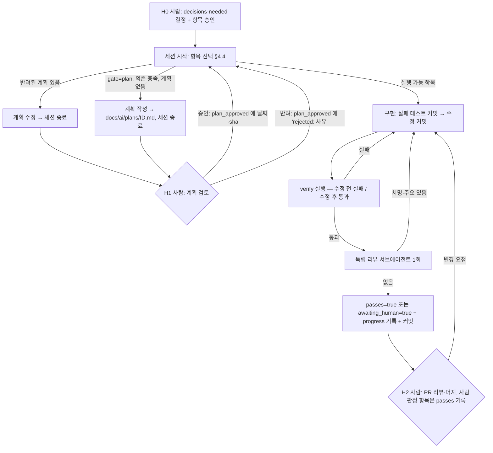

# AI 작업 흐름 제안 (ai-workflow)

> 상태: **제안 — 미확정**. 결정 항목은 [decisions-needed.md](./decisions-needed.md) D3·D5·D12.
> 이 문서는 "이 저장소에서 Claude Code 같은 코딩 에이전트에게 일을 맡기는 방법" 을 정한다. 외부 근거는 [research.md §8](./research.md#8-ai-코딩-에이전트-장시간-작업).
> 전제: architecture-proposal.md 추천안 B (모듈 경계). A′ 를 고르면 "모듈" 을 "기능 패키지" 로 읽으면 된다.
> 개정: Round 1 리뷰([reviews/ai-workflow-round-1.md](./reviews/ai-workflow-round-1.md)) 반영 — hook 재설계(C1), "수정 전 실패" verify(C2), `plan_approved` 필드(C3), OSIV 순서·게이트 규칙·init.sh 정정.
> 개정: Round 2 리뷰([reviews/ai-workflow-round-2.md](./reviews/ai-workflow-round-2.md)) 반영 — hook 이 `stop_hook_active` 로 풀리던 문제·base 비교 우회(C1·M1), `--tests` OR 결합으로 거짓 통과하던 verify(C2), 계획 반려 교착(C3), 사람 판정 항목 종료(M2), Docker 전제(M3), 기록 형식 고정(M4), 계획 작성 우선순위(M5), ARCH-A2 게이트(M6).

---

## 0. 지금 바로 AI 루프를 돌릴 수 없는 이유 (선행 조건)

에이전트 루프는 **기계가 판정하는 pass/fail 신호**가 있어야 스스로 닫힌다 ([F] https://code.claude.com/docs/en/best-practices — "Give Claude a way to verify its work"). 현재 이 저장소의 신호 상태:

| 신호 | 현재 | 문제 | 해결 항목 |
|---|---|---|---|
| `./gradlew test` | 테스트 1개 + ArchUnit 8개, `CoreApplicationTests` 가 **실 PostgreSQL 필요** | DB 없는 환경에서 항상 실패 → "원래 깨져 있음" 과 "내가 깨뜨림" 구분 불가 | `SIG-1` (D3) |
| 기능 테스트 | 0개 | F1(채점 API 항상 500)이 잠복한 이유 | `TEST-1` |
| 아키텍처 규칙 | ArchUnit 8개 중 **6개 `@Disabled`** (알려진 위반) | `./gradlew test` 통과가 규칙 준수를 뜻하지 않음 → verify 는 `@Disabled` 제거까지 확인 (§4.2) | `FIX-*`, `ARCH-*` |
| 포맷 | Spotless 추가됨, `enforceCheck = false` | 기존 `src/main` 29파일 미포맷 | `SIG-2` (D5) |
| Docker 데몬 | 이 클라우드 세션에서 **미기동** (`docker info` → `failed to connect to the docker API`, round-2 리뷰 [실행·리뷰]) | Testcontainers 기반 `integrationTest`(`FIX-F4` 의 `OsivConnectionIT`) 실행 불가 | 항목의 `requires: ["docker"]` + §4.4 선택 규칙 |

→ 첫 항목들은 "신호 만들기" 다. 단 **DB·Docker 없이 검증되는 항목은 `SIG-1` 을 기다리지 않는다** — `--tests` 필터로 실행하면 `CoreApplicationTests` 가 돌지 않기 때문. 해당: `TEST-1`, `FIX-F1`, `FIX-F1T`, `FIX-F2`, `FIX-R5`, `ARCH-A1` (decisions-needed.md §0 과 일치).

---

## 1. 작업 단위 설정

### 1.1 단위의 정의

**작업 단위 1개 = `feature_list.json` 항목 1개 = 커밋 1~3개 = PR 1개**

| 기준 | 규칙 | 이 저장소 예 |
|---|---|---|
| 검증 가능 | 항목마다 **수정 전에는 실패하고 수정 후에 통과하는** `verify` 명령을 미리 적는다 (§4.2) | `FIX-F1`: `! grep -rn '"FIX-F1 ' src/test` + 클래스별 테스트 실행 |
| 범위 | **모듈 1개** 안에서 끝난다. 2개 이상이면 쪼갠다 | `FIX-F2` 는 `common` + `resources` 만 |
| 크기 | `src/main` 변경 파일 **5개 이하** (estimated — 사람이 한 번에 리뷰 가능한 크기) | `ARCH-B2`(7파일) → `git mv` 커밋과 코드 수정 커밋으로 분리 |
| 독립성 | `depends_on` 을 명시 | `FIX-F4` depends_on `FIX-R5` (OSIV off 전에 DTO 반환) |
| 계약 | §2.2 게이트 규칙에 해당하면 `human_gate: "plan"` | `FIX-F3` (새 오류 코드 `BAD_REQUEST` 노출) |
| 환경 | 특별한 실행 환경이 필요하면 `requires` 에 적는다 | `FIX-F4`: `["docker"]` |

범위·크기 규칙의 **예외** (항목에 `module: "*"` 또는 배열로 표기):

| 예외 | 이유 | 예 |
|---|---|---|
| 기계적 포맷 커밋 | 의미 변경 0, `spotlessCheck` 가 판정 | `SIG-2` (30파일 — src/main 29 + 테스트 1) |
| 테스트만 추가 | `src/main` 변경 0 | `TEST-1` (3개 모듈에 테스트) |
| 빌드 설정 변경 | 모듈이 아닌 프로젝트 단위 | `SIG-1` |
| 모듈 경계 이동 | 이동 자체가 목적 | `ARCH-B2` |

### 1.2 단위로 만들면 안 되는 것

| 안 됨 | 이유 | 대신 |
|---|---|---|
| "예외 처리 개선" | 완료 판정 불가 | "깨진 JSON 이 400 `BAD_REQUEST` 를 반환한다" + 테스트 이름 |
| "sentence 리팩터링" | 범위 무한 | R5 위반 1건 해소 = 항목 1개 |
| 결정이 안 된 항목 | 되돌림 비용 | `feature_list.example.json` 의 `pending_decision` 에 두고, 결정 후 `items` 로 옮긴다 (`ARCH-B2`·`B3` 는 D1=B, `ARCH-A2` 는 D1=A′ 대기) |

---

## 2. 계획 → 구현 → 리뷰 흐름과 사람 확인 지점



### 2.1 단계별 산출물

| 단계 | 에이전트가 남기는 것 | 위치 |
|---|---|---|
| 계획 | 변경 예정 파일 목록, 추가할 테스트 이름, 영향받는 문서(05/06/03) | `docs/ai/plans/<id>.md` |
| 구현 | **실패하는 테스트 커밋 → 수정 커밋** 순서 (conventions-proposal.md §6.1 T2) | git |
| 검증 | §4.4 의 고정 형식 `verify: <id> OK` 줄 + 실행한 명령과 출력 요약 (성공 주장 대신 증거 — [F] best-practices "Have Claude show evidence rather than asserting success") | `docs/ai/claude-progress.md` |
| 리뷰 | 지적 사항 | `docs/ai/reviews/<id>-round-<N>.md` |

### 2.2 사람 확인 지점 (H0~H3)

| ID | 시점 | 사람이 보는 것 | 소요 (estimated) | 기록 방법 |
|---|---|---|---|---|
| **H0** | 루프 시작 전 | decisions-needed.md 결정, `feature_list.json` 항목 승인. D5 가 (a) 가 아니면 `SIG-2` 를 `items` 에서 뺀다 | 30분 | 항목을 `items` 에 넣는 커밋 |
| **H1** | `human_gate: "plan"` 항목의 구현 전 | `docs/ai/plans/<id>.md` 의 변경 파일 목록·계약 변경 여부 | 항목당 5분 | **사람이** `plan_approved` 에 날짜 또는 커밋 sha (승인) / `"rejected: <사유>"` (반려) |
| **H2** | PR 머지 | diff, 리뷰 파일, verify 출력. `verify: ["human"]` 항목은 판정 후 **사람이** `passes: true` | PR당 10~20분 | PR 승인 + feature_list 커밋 |
| **H3** | `blocked` 발생 시 | blockers.md 의 원인·시도 내역 | 수시 | `blocked` 를 `null` 로 되돌리거나 항목 수정 |

`human_gate: "plan"` 규칙 — 실제 배정(feature_list.example.json)과 1:1:

| 조건 | gate | 해당 항목 |
|---|---|---|
| 외부 API 응답을 **03 명세에 없는 방향**으로 바꿈 (새 오류 코드·상태 코드) | `plan` | `FIX-F3` (`BAD_REQUEST`·415 노출) |
| 03 명세가 이미 약속한 동작으로 되돌림 | `none` | `FIX-F1`(503 복구), `FIX-F1T`(timeout 503), `FIX-F2`(영문 메시지) |
| 런타임 동작 설정 변경 (`open-in-view` 등) | `plan` | `FIX-F4` |
| 패키지 이동 (`git mv`) | `plan` | `ARCH-B2` |
| 에이전트 자신의 판정 기준(ArchUnit 규칙)을 새로 씀 | `plan` | `ARCH-A2` (R2 를 A′ 규칙으로 교체 — 계획에 규칙 코드 포함) |
| `build.gradle` 의존성·태스크 추가 | `plan` | `SIG-1` |
| `docs/public` (05/06/03/99/02) 수정 | `plan` | `DOC-1`, `DOC-2` |
| H0 에서 이미 결정된 기계적 작업 | `none` | `SIG-2` (D5=(a) 결정 후 `spotlessApply`) |
| 그 외 (테스트 추가, 모듈 내부 수정) | `none` | `TEST-1`, `FIX-R5`, `ARCH-A1`, `ARCH-B3` |

### 2.3 독립 리뷰

- 구현한 에이전트와 **다른 서브에이전트**를 새로 띄워 "승인 전에 반드시 문제를 찾는 시니어 Spring 엔지니어" 역할로 리뷰시킨다. 근거: [F] best-practices — "A fresh context improves code review", "Add an adversarial review step".
- **코드 항목**: 1라운드, 통과 조건 = 치명·주요 0 + 리뷰어가 verify 를 직접 실행해 "수정 전 실패 → 수정 후 통과" 를 확인. 같은 문서의 경고("Tell the reviewer to flag only gaps that affect correctness or the stated requirements")에 따라 정확성·요구사항 밖의 지적은 반영 대상이 아니다.
- **문서·제안서 항목**: rubric 4개(근거성·구체성·일관성·판단 가능성) 각 1~5점, 모두 4점 이상 + 최소 2라운드 — 이 문서 세트를 만든 방식 ([reviews/](./reviews/)).
- 실제 효과: 이 문서 세트의 리뷰가 작성자가 놓친 **실행 가능한 결함**을 리뷰어의 프로브 실행으로 찾아냈다 — OSIV 커넥션 점유·`RestClient.Builder` 빈 부재([current-state-round-1.md](./reviews/current-state-round-1.md) C1·M2), 이 문서의 hook·verify 결함([ai-workflow-round-1.md](./reviews/ai-workflow-round-1.md) C1·C2, [round-2](./reviews/ai-workflow-round-2.md) C1·C2), read timeout 500([examples-round-1.md](./reviews/examples-round-1.md) C1).

---

## 3. 리뷰 체크리스트 (H2 와 서브에이전트 리뷰 공통)

"자동" 열: `✓` = 지금 기계 판정됨, `해제 후 ✓` = 해당 ArchUnit 규칙이 `@Disabled` 라 그 항목 완료 후부터 자동, `수동` = 사람/리뷰어.

| # | 확인 | 자동 |
|---|---|---|
| 1 | 항목의 `verify` 가 통과했다 | 기록 존재만 ✓ (§4.6 hook 이 이번 세션의 `verify: <id> OK` 줄을 확인). **통과 여부는 리뷰어가 재실행** (§2.3) |
| 2 | 수정 전 실패하던 테스트가 있다 (버그 수정 항목) | 수동 (git log 에서 테스트 커밋이 수정 커밋보다 앞인지) |
| 3 | 다른 모듈의 하위 패키지를 import 하지 않았다 | 해제 후 ✓ (R2 — `ARCH-B3`) |
| 4 | 서비스 public 메서드가 엔티티를 반환하지 않는다 | 해제 후 ✓ (R5 — `FIX-R5`) |
| 5 | 같은 클래스에서 `@Transactional` 메서드를 호출하지 않는다 | 해제 후 ✓ (R6 — `FIX-F4`) |
| 6 | HTTP Interface 파라미터에 바인딩 어노테이션 | 해제 후 ✓ (R7 — `FIX-F1`) |
| 7 | 외부 호출이 `@Transactional` 메서드 안에 없다 | 수동 (규칙 미작성) |
| 8 | throw 직전에 로그를 남기지 않았다 (스케줄러 진입점 제외) | 수동 |
| 9 | 로그 형식 `"{대상} {동작}: key=value"`, 토큰·시크릿 없음 | 수동 |
| 10 | 외부 계약(03) 변경이 있으면 03 도 같은 PR 에서 수정 | 수동 |
| 11 | `src/main` 변경 파일 ≤ 5 (§1.1 예외 제외) | 수동 (`git diff --stat origin/main...HEAD -- src/main`) |
| 12 | 컨트롤러·서비스·리포지토리 레이어 방향, domain 독립 | ✓ (R4, R4b) |
| 13 | feature_list 의 사람 전용 필드를 바꾸지 않았다 | ✓ (§4.6 hook — base 대비 비교) |

---

## 4. `feature_list.json` 기반 장시간 루프

근거: Anthropic, "Effective harnesses for long-running agents" (2025-11-26) — initializer 세션 + coding 세션, feature list 의 `passes` 만 수정, 한 번에 기능 1개, `init.sh` 로 기동·기본 검증, 진행 파일 + git 으로 세션 간 기억. [F] https://www.anthropic.com/engineering/effective-harnesses-for-long-running-agents

### 4.1 파일 구성

| 파일 | 역할 | 수정 권한 |
|---|---|---|
| `docs/ai/feature_list.json` | 작업 항목과 완료 여부 | 사람: 그 외 전부. 에이전트: **`passes`, `blocked`, `awaiting_human` 만** (원문은 `passes` 만 — 나머지 둘은 이 저장소 확장). 사람 판정 항목(`verify: ["human"]`)의 `passes` 는 사람만 |
| `docs/ai/plans/<id>.md` | gate=plan 항목의 계획 | 에이전트 작성, 사람 검토 |
| `docs/ai/claude-progress.md` | 세션별 진행 로그 (append-only). 원문은 `claude-progress.txt` — 표·코드 블록을 쓰기 위해 `.md` | 에이전트 (`session-base` 줄은 hook) |
| `scripts/init.sh` | 기동 + 기본 검증 (§4.3) | 사람 승인 후 추가 (이번 작업 범위 밖이라 미생성) |
| `.claude/hooks/session-base.sh` | SessionStart hook — 세션 시작 커밋을 `.git/claude-session-base` 에 기록 (§4.6) | 사람 승인 후 추가 |
| `.claude/hooks/check-feature.sh` | Stop hook 게이트 (§4.6) | 사람 승인 후 추가 |
| `.claude/hooks/check-done.sh` | 이 문서 세트 작성용 게이트 (`checklist.json`) — **feature 루프 시작 시 settings.json 에서 내린다** | 사람 |
| `CLAUDE.md` | 세션 시작 시 자동 로드되는 규칙 요약 | 사람 승인 |

- 예시 파일: [`feature_list.example.json`](./feature_list.example.json).
- JSON 을 쓰는 이유: Markdown 보다 모델이 부적절하게 수정·덮어쓸 가능성이 낮았다는 원문의 관찰 [F].

### 4.2 항목 스키마와 verify 원칙

```json
{
  "id": "FIX-F1",
  "title": "SimilarityClient.score 에 @RequestBody — 채점 API 항상 500 해소",
  "module": "infra.similarity",
  "depends_on": ["TEST-1"],
  "human_gate": "none",
  "plan_approved": null,
  "requires": [],
  "verify": [
    "! grep -rn '\"FIX-F1 ' src/test",
    "! grep -rn '\"R7 위반' src/test",
    "bash ./gradlew test --tests '*SimilarityClientTest' && grep -q 'skipped=\"0\"' build/test-results/test/TEST-*.SimilarityClientTest.xml",
    "bash ./gradlew test --tests '*ConventionArchitectureTest' && grep -q 'skipped=\"0\"' build/test-results/test/TEST-*.ConventionArchitectureTest.xml"
  ],
  "acceptance": "SimilarityClientTest·ArchUnit R7 의 @Disabled 제거 후 통과",
  "evidence": "current-state.md F1, §7.2 P8",
  "passes": false,
  "blocked": null,
  "awaiting_human": false
}
```

**verify 원칙 — 지금 상태에서 실행하면 실패해야 한다.** 단 verify 는 그 항목 PR 시점에만 유효하다 (예: `TEST-1` 의 "`FIX-F1 ` 사유가 있음" 은 `FIX-F1` 이후엔 실패한다) — 회귀 검사용이 아니다.

| 함정 | 예 | 대응 |
|---|---|---|
| 대상 규칙이 `@Disabled` 라 skip 되어 통과 | `--tests '*ArchitectureTest*'` 는 지금도 `BUILD SUCCESSFUL` (8개 중 6개 skip) | `! grep -rn '"R7 위반' src/test` 로 **`@Disabled` 사유 문자열이 사라졌는지** 확인 — palantir 포맷이 `@Disabled(` 와 사유를 다른 줄로 나누므로 어노테이션 이름이 아니라 사유로 grep |
| **`--tests` 를 여러 개 주면 OR** — 하나만 매칭돼도 통과 | 한 명령에 3클래스를 주면 2개가 없어도 통과 (round-2 C2 [실행·리뷰]) | **클래스마다 명령 1개**. 단일 필터는 매칭 0이면 `No tests found` 로 실패 |
| 클래스가 있어도 전부 `@Disabled` 면 skip 된 채 통과 | `TEST-1` | 실행돼야 하는 클래스는 `grep -q 'skipped="0"' build/test-results/test/TEST-*.<Class>.xml` 을 덧붙임 |
| 환경에 DB 가 있어 통과 | `SIG-1` 의 `./gradlew test` | `SPRING_DATASOURCE_URL=jdbc:postgresql://localhost:1/none bash ./gradlew test` — DB 를 막고 실행 |
| 사유 접두사 충돌 | `"FIX-F1` 은 `"FIX-F1T` 도 잡음 | 사유 형식을 **`<ID>` + 공백** 으로 고정하고 grep 도 `'"FIX-F1 '` |
| 사람만 판정 가능 | `DOC-1`, `DOC-2` | `"verify": ["human"]` — 에이전트는 `awaiting_human: true` 까지만 (hook 이 차단) |

첫 항목들 (순서 = 배열 순서. 전체는 [feature_list.example.json](./feature_list.example.json)):

| 순서 | id | 내용 | gate | depends_on | requires |
|---|---|---|---|---|---|
| 1 | `TEST-1` | DB 없이 도는 테스트 3종 (현재 실패하는 2개는 `@Disabled("FIX-F1 …")`/`("FIX-F2 …")`) | none | — | — |
| 2 | `FIX-F1` | `@RequestBody` | none | TEST-1 | — |
| 3 | `FIX-F1T` | read timeout·빈 응답 → 503 (F1 수정 직후 표면화) | none | FIX-F1 | — |
| 4 | `FIX-F2` | basename + fallback | none | TEST-1 | — |
| 5 | `SIG-1` | `CoreApplicationTests` → `integration` 태그 + Testcontainers | plan | — | — |
| 6 | `SIG-2` | `spotlessApply` + `enforceCheck = true` (D5=(a) 일 때만 등록) | none | — | — |
| 7 | `FIX-F3` | `GlobalExceptionHandler` + 로그 레벨 | plan | FIX-F2, SIG-2 | — |
| 8 | `FIX-R5` | `SentenceService` DTO 반환 (R5) | none | TEST-1 | — |
| 9 | `FIX-F4` | self-invocation 제거 + OSIV off (`OsivConnectionIT`) | plan | **FIX-R5**, SIG-1 | **docker** |
| 10 | `ARCH-A1` | Similarity 빈 설정을 `common` 밖으로 (R1·R3) | none | FIX-F1 | — |
| 11 | `DOC-1` | 05/06/99/03 수정 (구조 무관분) | plan | FIX-F3, FIX-F4 | — |
| 보류 | `ARCH-B2` → `ARCH-B3` → `DOC-2` / `ARCH-A2` → `DOC-2` | `pending_decision["D1=B"]` / `["D1=A'"]` | B2·A2·DOC-2 plan | ARCH-A1, FIX-F1T | — |

- `FIX-F4` 가 `FIX-R5` 에 의존: OSIV 를 끄기 전에 엔티티가 트랜잭션 밖으로 나가지 않아야 한다 (conventions-proposal.md §3.4, decisions-needed.md D4).
- `SIG-2` 를 `FIX-F3` 앞에 둠: `GlobalExceptionHandler` 를 크게 고치기 전에 포맷 소음을 없앤다. `SIG-2` 자체는 `SIG-1` 에 의존하지 않는다 (round-2 m9 — 근거 없는 의존 제거).
- `ARCH-B2`·`A2` 가 `FIX-F1T` 에 의존: F1T 가 `AnswerService` 에 넣은 catch 를 `SimilarityScorer` 로 옮기는 작업이라 순서가 고정돼야 한다.

### 4.3 `init.sh` (제안 — 파일은 승인 후 추가)

```bash
#!/usr/bin/env bash
# 세션 시작 시 1회: 환경 확인 + 기본 신호. 실패해도 끝까지 출력하고 마지막에 요약.
set -uo pipefail
cd "$(dirname "$0")/.."
git log --oneline -10
java -version 2>&1 | grep -m1 version
summary=()
if docker info >/dev/null 2>&1; then summary+=("docker: OK"); else summary+=("docker: 없음 — requires=docker 항목 건너뜀"); fi
if jq -e '.items[] | select(.id=="SIG-1") | .passes' docs/ai/feature_list.json >/dev/null; then
  # SIG-1 이후: DB 를 막고도 통과해야 함 (DB 필요한 테스트가 integration 태그 없이 들어오면 여기서 잡힘)
  SPRING_DATASOURCE_URL=jdbc:postgresql://localhost:1/none bash ./gradlew test --console=plain \
    && summary+=("test: OK") || summary+=("test: FAIL")
else
  bash ./gradlew compileTestJava --console=plain \
    && summary+=("compile: OK (SIG-1 전 — 전체 test 는 DB 필요)") || summary+=("compile: FAIL")
fi
bash ./gradlew spotlessCheck --console=plain >/dev/null 2>&1 \
  && summary+=("spotless: OK") || summary+=("spotless: 위반 있음 (SIG-2 전에는 정보용)")
# 스모크 (SIG-1 이후, DB 가 있는 환경에서만): bootRun 후 출제 API 1회 호출 — 원문의 "기본 end-to-end 확인" [F]
printf '%s\n' "${summary[@]}"
printf '%s\n' "${summary[@]}" | grep -q 'FAIL' && exit 1 || exit 0
```

- 실행은 `bash scripts/init.sh` — `gradlew` 처럼 실행 권한 없이 커밋될 수 있으므로 (blockers.md §2 #1, D11).
- `git log` 를 맨 앞에 둬 실패해도 출력된다. `set -e` 를 쓰지 않고 마지막에 요약을 출력한다.
- `java -version` 은 이 환경에서 `Picked up JAVA_TOOL_OPTIONS` 줄을 먼저 내므로 `grep -m1 version`.
- 원문의 init.sh 는 개발 서버를 띄우고 기본 end-to-end 테스트를 한다 [F]. F1(호출하면 500)은 바로 그 스모크가 잡는 결함이다 → `SIG-1` 이후 스모크 활성화 권장.

### 4.4 세션 루틴

**기록 형식 (이 형식만 인정 — hook 이 문자 그대로 비교)**

```text
session-base: <40자 sha>          ← SessionStart hook 이 자동으로 씀. 직접 쓰지 않는다
verify: <ID> OK                   ← 줄 전체가 정확히 이 형태. 목록 기호(-)·백틱·다른 문구 금지
```

**시작 (매 세션)**

1. `git log --oneline -20` → `docs/ai/claude-progress.md` 마지막 블록 → `docs/ai/feature_list.json`
2. `bash scripts/init.sh`. **실패하면 새 항목을 시작하지 않고** 깨진 원인부터 (직전 세션이 남긴 문제일 가능성)
3. 항목 선택 — 아래 우선순위대로 배열 순서상 첫 번째 1개. 공통 제외 조건: `passes: true`, `blocked` 가 null 아님, `awaiting_human: true`, `requires` 를 이 환경이 충족하지 않음(예: Docker 없음 — init.sh 요약), `depends_on` 미충족
   1. `plan_approved` 가 `"rejected: …"` 인 항목 → **계획을 고치고 세션 종료** (H1 재요청)
   2. `human_gate: plan` + `plan_approved: null` + `docs/ai/plans/<id>.md` 없음 → **계획만 작성하고 세션 종료** (H1 대기가 뒤로 밀리지 않게 구현보다 우선)
   3. `human_gate: none`, 또는 `plan_approved` 에 날짜·sha 가 있는 항목 → 구현
   4. 해당 없음 → progress 에 "대기 중: <id 목록과 이유>" 를 쓰고 종료

**진행**

4. 실패 테스트 커밋 → 구현 커밋 → `verify` 실행 → progress 에 `verify: <id> OK` + 명령·출력 요약
5. 서브에이전트 리뷰 (§2.3) → 반영

**종료**

6. 일반 항목: `passes: true`. 사람 판정 항목(`verify: ["human"]`): `awaiting_human: true` — 사람이 H2 에서 `passes: true` 로 바꾼다. 커밋
7. 실패로 끝나면 `blocked: "<원인 한 줄>"` + blockers.md 에 상세
8. progress 에 "다음 세션이 알아야 할 것" 3줄 이내

### 4.5 루프 운영 규칙

| 규칙 | 이유 |
|---|---|
| 한 세션 = 한 항목, 다음 항목은 새 세션 | 원문은 "work on only one feature at a time" [F]. 세션 분리는 컨텍스트 오염을 줄이려는 **이 문서의 판단** |
| 에이전트는 사람 전용 필드(`verify`·`acceptance`·`id`·`depends_on`·`human_gate`·`plan_approved`·`requires`)를 고치지 않는다 | 원문: "It is unacceptable to remove or edit tests because this could lead to missing or buggy functionality." [F]. hook 이 base 대비 비교로 강제 (§4.6) |
| **기존** 테스트를 `@Disabled` 로 끄는 것은 `blocked` 와 함께만 | 같은 이유. 단 `TEST-1` 처럼 **새 테스트를 예정된 FIX id 와 묶어 `@Disabled("<ID> …")` 로 추가**하는 것은 허용 — 그 FIX 의 verify 가 해제를 확인 |
| 같은 항목이 2세션 연속 실패하면 `blocked` | 무한 재시도 방지. 환경 미충족(`requires`)으로 건너뛴 것은 실패로 세지 않는다 |
| `blocked` 3개 이상이면 루프 중단 → H3 | 구조적 문제 신호. `awaiting_human` 은 세지 않는다 |
| 30분 이상 환경 문제 → blockers.md 기록 후 분석 가능한 범위까지 | 이 작업의 TASK.md 규칙과 동일 |

### 4.6 hook — SessionStart 로 base 기록, Stop 으로 게이트

근거: [F] https://code.claude.com/docs/en/hooks — Stop hook 의 exit 2 는 "Prevents Claude from stopping, continues the conversation". `stop_hook_active` 는 "to avoid blocking on a condition that will never resolve" 용도이며, Claude Code 는 연속 8회 continuation 상한을 두고 도구 호출 시 초기화한다.

**설계 판단**: 이 hook 이 막는 조건(기록 누락, 사람 전용 필드 변경, 사람 판정 항목의 `passes`)은 **모두 에이전트가 되돌리거나 verify 를 실행하면 해소된다** — "never resolve" 조건이 아니다. 그래서 `stop_hook_active` 로 빠져나가지 않고(Round 1 판의 결함 — 두 번째 종료 시도에서 풀렸다), 무한 차단은 내장 8회 상한에 맡긴다. 포기하는 것: 8회 연속 막힌 뒤의 종료는 hook 이 통제하지 못한다 → 그 경우 다음 세션 init.sh·H2 에서 드러난다.

```bash
#!/bin/bash
# 제안: .claude/hooks/session-base.sh — SessionStart hook. 세션 시작 커밋을 기록하고 progress 에 표식을 남긴다.
[ "$CLAUDE_CODE_REMOTE" = "true" ] || exit 0
cd "$CLAUDE_PROJECT_DIR" || exit 0
git rev-parse HEAD > .git/claude-session-base
printf '\nsession-base: %s\n' "$(cat .git/claude-session-base)" >> docs/ai/claude-progress.md
```

```bash
#!/bin/bash
# 제안: .claude/hooks/check-feature.sh — Stop hook
# 이번 세션에서 passes=true 가 된 항목마다 progress 에 그 세션의 verify 기록이 있어야 하고,
# 사람 전용 필드·판정 기준은 세션 시작 시점(base)에서 바뀌면 안 된다.
[ "$CLAUDE_CODE_REMOTE" = "true" ] || exit 0
cd "$CLAUDE_PROJECT_DIR" || exit 0
f=docs/ai/feature_list.json; p=docs/ai/claude-progress.md
[ -f "$f" ] || exit 0
block() { echo "$1" >&2; exit 2; }
# stop_hook_active 로 빠져나가지 않는다 — 막는 조건은 모두 에이전트가 해소할 수 있고,
# 무한 차단은 Claude Code 내장 상한(연속 8회)이 끊는다 (ai-workflow.md §4.6).

base=$(cat .git/claude-session-base 2>/dev/null)          # SessionStart hook 이 기록 (아래)
[ -n "$base" ] || block "세션 base 가 없음 — SessionStart hook(.claude/hooks/session-base.sh) 확인."
jq -e . "$f" >/dev/null 2>&1 || block "feature_list.json 이 올바른 JSON 이 아님."
all='(.items + ([.pending_decision // {} | .[]] | add // []))'
jq -e "[$all[] | (.passes | type == \"boolean\")] | all" "$f" >/dev/null || block "passes 는 true/false(boolean)만 허용."
old=$(git show "$base:$f" 2>/dev/null) || exit 0          # base 에 파일이 없으면(첫 등록) 검사 생략

# 1) 사람 전용 필드 불변: id 목록, verify, acceptance, human_gate, plan_approved, depends_on, requires (pending_decision 포함)
fixed="[$all[] | {id, verify, acceptance, human_gate, plan_approved, depends_on, requires}] | sort_by(.id)"
[ "$(jq -S "$fixed" <<<"$old")" = "$(jq -S "$fixed" "$f")" ] \
  || block "사람 전용 필드(id·verify·acceptance·human_gate·plan_approved·depends_on·requires)가 세션 중 바뀜 — 되돌릴 것."

# 2) 새로 passes=true 가 된 항목 (passes 는 boolean true 만 인정)
ids() { jq -r "[$all[] | select(.passes == true) | .id] | .[]" | sort; }
newly=$(comm -13 <(ids <<<"$old") <(ids < "$f"))
# 이번 세션 기록만: progress 의 "session-base: <base>" 줄 이후
records=$(awk -v b="session-base: $base" 'found{print} $0==b{found=1}' "$p" 2>/dev/null)
for id in $newly; do
  if jq -e --arg id "$id" '.items[] | select(.id==$id) | .verify == ["human"]' "$f" >/dev/null; then
    block "$id 는 사람 판정 항목 — 에이전트는 awaiting_human=true 까지만 (§4.4)."
  fi
  grep -qx "verify: $id OK" <<<"$records" || block "$id: 이번 세션 progress 에 'verify: $id OK' 줄 없음."
done
exit 0
```

임시 git 저장소에서 **직접 실행**한 시나리오 [실행] (Round 1 의 5개 + Round 2 리뷰의 우회 N1~N11):

| 시나리오 | Round 1 판 | Round 2 판 (`stop_hook_active` 탈출) | 이 판 |
|---|---|---|---|
| passes=true, 이번 세션 기록 없음 | 차단 | 차단 | **차단** |
| 같은 상태에서 두 번째 종료 시도 (`stop_hook_active: true`) | — | **통과 (결함)** | **차단** |
| 다른 id 의 기록만 있음 | 통과 (결함) | 차단 | **차단** |
| compact JSON `"passes":true` | 통과 (결함) | 차단 | **차단** |
| 이전 세션의 같은 id 기록만 있음 (N3) | — | 통과 (결함) | **차단** — `session-base` 줄 이후만 검색 |
| `session-base` 줄을 progress 에 추가로 위조 (N2) | — | 통과 (결함) | 영향 없음 — base 는 `.git/claude-session-base` 에서 읽음 |
| 깨진 JSON (N1) | — | 통과 (결함) | **차단** |
| 사람 판정 항목의 `verify` 를 바꿈 (N4) | — | 통과 (결함) | **차단** — 사람 전용 필드 비교 |
| 사람 판정 항목 `passes: true` | — | 1회만 차단 | **차단** |
| 실패 항목을 `items` 에서 삭제 (N7) | — | 통과 (결함) | **차단** — id 목록 비교 |
| `pending_decision` 안 항목의 `passes` (N10) | — | 미검사 | **검사** |
| 문자열 `"true"` (N11) | — | 미검사 | **차단** — boolean 만 허용 |
| true → false 되돌림 | 차단 (결함) | 통과 | **통과** (정상) |
| 기록 후 커밋 추가 | 통과 (결함) | 검사 유지 | **통과** (정상 — 기록 있음) |

**기존 `check-done.sh` 의 결함** (이 문서 세트 작성용 hook, 수정은 범위 밖): 카운터 `/tmp/stop-hook-count` 를 초기화하지 않아 세션이 바뀌어도 누적 → 15회 이후 그 머신에서 게이트가 영구히 꺼진다. 위 hook 은 카운터 대신 내장 8회 상한을 쓴다. feature 루프 시작 시 `check-done.sh` 는 settings.json 에서 내린다 (decisions-needed.md D12).

### 4.7 실패 유형과 대응 (원문의 4유형을 이 저장소에 대입)

| 유형 [F] | 이 저장소에서의 모습 | 대응 |
|---|---|---|
| 너무 일찍 완료 선언 | `./gradlew build` 가 DB 없어서 실패하는데 "환경 문제" 로 넘김 | `SIG-1`, Stop hook |
| 버그·미기록 상태로 종료 | WIP 가 미커밋 상태로 남음 (이 저장소가 실제로 그랬다 — current-state.md §5) | 세션 종료 시 커밋, progress 기록 |
| 검증 없이 passing 표시 | F1 처럼 "컴파일은 되는데 호출하면 500", `@Disabled` 로 skip 된 규칙이나 OR 결합된 `--tests` 를 "통과" 로 착각 | §4.2 verify 원칙, hook 의 이번 세션 기록 확인, 리뷰어 재실행 |
| 실행 방법 탐색에 시간 낭비 | `gradlew` 권한, Maven 429, PostgreSQL 기동, Docker 데몬 부재 (blockers.md §2 — 이 작업에서 약 15분) | `init.sh`, CLAUDE.md 의 빌드 명령, `requires` |

---

## 5. CLAUDE.md 와의 관계

- CLAUDE.md 는 세션마다 자동 로드되므로 **200줄 미만**: "Size: target under 200 lines per CLAUDE.md file. Longer files consume more context and reduce adherence." ([F] https://code.claude.com/docs/en/memory)
- 각 줄에 "지우면 에이전트가 실수할까?" 를 묻는다 ([F] best-practices "Would removing this cause Claude to make mistakes?"): 빌드·테스트 명령, 모듈 경계 규칙, 트랜잭션·로깅 금지 사항, 알려진 함정(basename, `RestClient.Builder` 부재, 테스트 Lombok 부재). 상세는 이 문서들로 링크.
- 초안: [/CLAUDE.md](../../CLAUDE.md).
