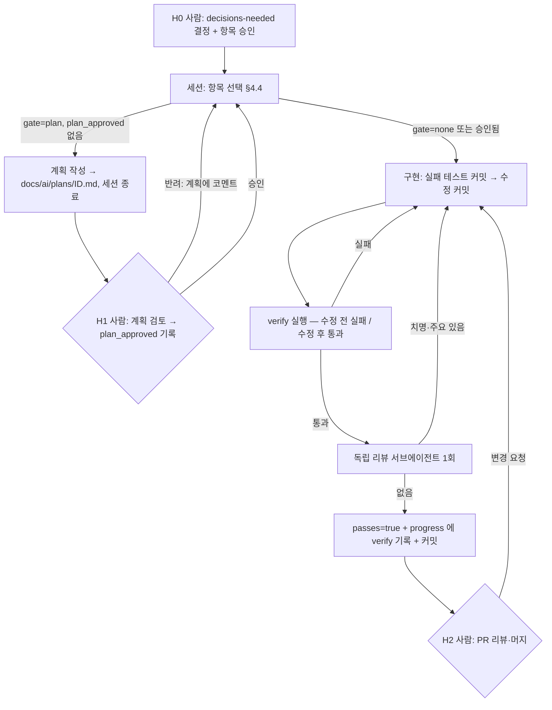

# AI 작업 흐름 제안 (ai-workflow)

> 상태: **제안 — 미확정**. 결정 항목은 [decisions-needed.md](./decisions-needed.md) D3·D5·D12.
> 이 문서는 "이 저장소에서 Claude Code 같은 코딩 에이전트에게 일을 맡기는 방법" 을 정한다. 외부 근거는 [research.md §8](./research.md#8-ai-코딩-에이전트-장시간-작업).
> 전제: architecture-proposal.md 추천안 B (모듈 경계). A 를 고르면 "모듈" 을 "기능 패키지" 로 읽으면 된다.
> 개정: Round 1 리뷰([reviews/ai-workflow-round-1.md](./reviews/ai-workflow-round-1.md)) 반영 — hook 재설계(C1), "수정 전 실패" verify(C2), `plan_approved` 필드(C3), OSIV 순서·게이트 규칙·init.sh 정정.

---

## 0. 지금 바로 AI 루프를 돌릴 수 없는 이유 (선행 조건)

에이전트 루프는 **기계가 판정하는 pass/fail 신호**가 있어야 스스로 닫힌다 ([F] https://code.claude.com/docs/en/best-practices — "Give Claude a way to verify its work"). 현재 이 저장소의 신호 상태:

| 신호 | 현재 | 문제 | 해결 항목 |
|---|---|---|---|
| `./gradlew test` | 테스트 1개 + ArchUnit 8개, `CoreApplicationTests` 가 **실 PostgreSQL 필요** | DB 없는 환경에서 항상 실패 → "원래 깨져 있음" 과 "내가 깨뜨림" 구분 불가 | `SIG-1` (D3) |
| 기능 테스트 | 0개 | F1(채점 API 항상 500)이 잠복한 이유 | `TEST-1` |
| 아키텍처 규칙 | ArchUnit 8개 중 **6개 `@Disabled`** (알려진 위반) | `./gradlew test` 통과가 규칙 준수를 뜻하지 않음 → verify 는 `@Disabled` 제거까지 확인해야 함 (§4.2) | `FIX-*`, `ARCH-*` |
| 포맷 | Spotless 추가됨, `enforceCheck = false` | 기존 `src/main` 29파일 미포맷 | `SIG-2` (D5) |

→ 첫 항목들은 "신호 만들기" 다. 단, **DB 없이 도는 테스트(`TEST-1`)와 1~2줄 수정(`FIX-F1`·`FIX-F2`)은 `SIG-1` 을 기다리지 않는다** — `--tests` 필터로 실행하면 `CoreApplicationTests` 가 돌지 않기 때문 (decisions-needed.md §0 과 일치).

---

## 1. 작업 단위 설정

### 1.1 단위의 정의

**작업 단위 1개 = `feature_list.json` 항목 1개 = 커밋 1~3개 = PR 1개**

| 기준 | 규칙 | 이 저장소 예 |
|---|---|---|
| 검증 가능 | 항목마다 **수정 전에는 실패하고 수정 후에 통과하는** `verify` 명령을 미리 적는다 (§4.2) | `FIX-F1`: `! grep -rn '"FIX-F1' src/test` + `--tests '*SimilarityClientTest'` |
| 범위 | **모듈 1개** 안에서 끝난다. 2개 이상이면 쪼갠다 | `FIX-F2` 는 `common` + `resources` 만 |
| 크기 | `src/main` 변경 파일 **5개 이하** (estimated — 사람이 한 번에 리뷰 가능한 크기) | `ARCH-B2`(7파일) → `git mv` 커밋과 코드 수정 커밋으로 분리 |
| 독립성 | `depends_on` 을 명시 | `FIX-F4` depends_on `FIX-R5` (OSIV off 전에 DTO 반환) |
| 계약 | §2.2 게이트 규칙에 해당하면 `human_gate: "plan"` | `FIX-F3` (새 오류 코드 `BAD_REQUEST` 노출) |

범위·크기 규칙의 **예외** (항목에 `module: "*"` 또는 배열로 표기):

| 예외 | 이유 | 예 |
|---|---|---|
| 기계적 포맷 커밋 | 의미 변경 0, `spotlessCheck` 가 판정 | `SIG-2` (30파일 — src/main 29 + 테스트 1) |
| 테스트만 추가 | `src/main` 변경 0 | `TEST-1` (3개 모듈에 테스트) |
| 빌드 설정 변경 | 모듈이 아닌 프로젝트 단위 | `SIG-1` |
| 모듈 경계 이동 | 이동 자체가 목적 | `ARCH-B2` |

### 1.2 단위로 만들면 안 되는 것

| 안 됨 | 이유 | 대신 |
|---|---|---|
| "예외 처리 개선" | 완료 판정 불가 | "깨진 JSON 이 400 `BAD_REQUEST` 를 반환한다" + 테스트 이름 |
| "sentence 리팩터링" | 범위 무한 | R5 위반 1건 해소 = 항목 1개 |
| 결정이 안 된 항목 | 되돌림 비용 | `feature_list.example.json` 의 `pending_decision` 에 두고, 결정 후 `items` 로 옮긴다 (`ARCH-B2`·`B3` 는 D1=B 대기) |

---

## 2. 계획 → 구현 → 리뷰 흐름과 사람 확인 지점



### 2.1 단계별 산출물

| 단계 | 에이전트가 남기는 것 | 위치 |
|---|---|---|
| 계획 | 변경 예정 파일 목록, 추가할 테스트 이름, 영향받는 문서(05/06/03) | `docs/ai/plans/<id>.md` |
| 구현 | **실패하는 테스트 커밋 → 수정 커밋** 순서 (conventions-proposal.md §6.1 T2) | git |
| 검증 | `verify: <id>` 로 시작하는 줄 + 실행한 명령과 출력 요약 (성공 주장 대신 증거 — [F] best-practices "Have Claude show evidence rather than asserting success") | `docs/ai/claude-progress.md` |
| 리뷰 | 지적 사항 | `docs/ai/reviews/<id>-round-<N>.md` |

### 2.2 사람 확인 지점 (H0~H3)

| ID | 시점 | 사람이 보는 것 | 소요 (estimated) | 기록 방법 |
|---|---|---|---|---|
| **H0** | 루프 시작 전 | decisions-needed.md 결정, `feature_list.json` 항목 승인 | 30분 | 항목을 `items` 에 넣는 커밋 |
| **H1** | `human_gate: "plan"` 항목의 구현 전 | `docs/ai/plans/<id>.md` 의 변경 파일 목록·계약 변경 여부 | 항목당 5분 | **사람이** `feature_list.json` 의 `plan_approved` 에 날짜 또는 커밋 sha 기록 |
| **H2** | PR 머지 | diff, 리뷰 파일, verify 출력 | PR당 10~20분 | PR 승인 |
| **H3** | `blocked` 발생 시 | blockers.md 의 원인·시도 내역 | 수시 | `blocked` 를 `null` 로 되돌리거나 항목 수정 |

`human_gate: "plan"` 규칙 — 실제 배정(feature_list.example.json)과 1:1 로 맞춘 표:

| 조건 | gate | 해당 항목 |
|---|---|---|
| 외부 API 응답을 **03 명세에 없는 방향**으로 바꿈 (새 오류 코드·상태 코드) | `plan` | `FIX-F3` (`BAD_REQUEST`·415 노출) |
| 03 명세가 이미 약속한 동작으로 되돌림 | `none` | `FIX-F1`(503 복구), `FIX-F2`(영문 메시지) |
| 런타임 동작 설정 변경 (`open-in-view` 등) | `plan` | `FIX-F4` |
| 패키지 이동 (`git mv`) | `plan` | `ARCH-B2` |
| `build.gradle` 의존성·태스크 추가 | `plan` | `SIG-1` |
| `docs/public` (05/06/03/99) 수정 | `plan` | `DOC-1` |
| H0 에서 이미 결정된 기계적 작업 | `none` | `SIG-2` (D5 결정 후 `spotlessApply`) |
| 그 외 (테스트 추가, 모듈 내부 수정) | `none` | `TEST-1`, `FIX-F1T`, `FIX-R5`, `ARCH-A1`, `ARCH-B3`, `ARCH-A2` |

### 2.3 독립 리뷰

- 구현한 에이전트와 **다른 서브에이전트**를 새로 띄워 "승인 전에 반드시 문제를 찾는 시니어 Spring 엔지니어" 역할로 리뷰시킨다. 근거: [F] best-practices — "A fresh context improves code review", "Add an adversarial review step".
- **코드 항목**: 1라운드, 통과 조건 = 치명·주요 0 + 리뷰어가 verify 를 직접 실행해 "수정 전 실패 → 수정 후 통과" 를 확인. 같은 문서의 경고("Tell the reviewer to flag only gaps that affect correctness or the stated requirements")에 따라 정확성·요구사항 밖의 지적은 반영 대상이 아니다.
- **문서·제안서 항목**: rubric 4개(근거성·구체성·일관성·판단 가능성) 각 1~5점, 모두 4점 이상 + 최소 2라운드 — 이 문서 세트를 만든 방식 ([reviews/](./reviews/)).
- 실제 효과: 이 문서 세트의 1라운드 리뷰가 작성자가 놓친 **실행 가능한 결함**(OSIV 커넥션 점유, `RestClient.Builder` 빈 부재, 이 문서의 hook 스크립트 결함)을 리뷰어의 프로브 실행으로 찾아냈다 ([current-state-round-1.md](./reviews/current-state-round-1.md) C1·M2, [ai-workflow-round-1.md](./reviews/ai-workflow-round-1.md) C1).

---

## 3. 리뷰 체크리스트 (H2 와 서브에이전트 리뷰 공통)

"자동" 열: `✓` = 지금 기계 판정됨, `해제 후 ✓` = 해당 ArchUnit 규칙이 `@Disabled` 라 해당 항목 완료 후부터 자동, `수동` = 사람/리뷰어.

| # | 확인 | 자동 |
|---|---|---|
| 1 | 항목의 `verify` 가 통과하고 progress 에 `verify: <id>` 기록이 있다 | ✓ (§4.6 hook 이 id 별로 확인) |
| 2 | 수정 전 실패하던 테스트가 있다 (버그 수정 항목) | 수동 (git log 에서 테스트 커밋이 수정 커밋보다 앞인지) |
| 3 | 다른 모듈의 하위 패키지를 import 하지 않았다 | 해제 후 ✓ (R2 — `ARCH-B3`) |
| 4 | 서비스 public 메서드가 엔티티를 반환하지 않는다 | 해제 후 ✓ (R5 — `FIX-R5`) |
| 5 | 같은 클래스에서 `@Transactional` 메서드를 호출하지 않는다 | 해제 후 ✓ (R6 — `FIX-F4`) |
| 6 | HTTP Interface 파라미터에 바인딩 어노테이션 | 해제 후 ✓ (R7 — `FIX-F1`) |
| 7 | 외부 호출이 `@Transactional` 메서드 안에 없다 | 수동 (규칙 미작성) |
| 8 | throw 직전에 로그를 남기지 않았다 (스케줄러 진입점 제외) | 수동 |
| 9 | 로그 형식 `"{대상} {동작}: key=value"`, 토큰·시크릿 없음 | 수동 |
| 10 | 외부 계약(03) 변경이 있으면 03 도 같은 PR 에서 수정 | 수동 |
| 11 | `src/main` 변경 파일 ≤ 5 (§1.1 예외 제외) | 수동 (`git diff --stat origin/main...HEAD -- src/main`) |
| 12 | 컨트롤러·서비스·리포지토리 레이어 방향, domain 독립 | ✓ (R4, R4b) |

---

## 4. `feature_list.json` 기반 장시간 루프

근거: Anthropic, "Effective harnesses for long-running agents" (2025-11-26) — initializer 세션 + coding 세션, feature list 의 `passes` 만 수정, 한 번에 기능 1개, `init.sh` 로 기동·기본 검증, 진행 파일 + git 으로 세션 간 기억. [F] https://www.anthropic.com/engineering/effective-harnesses-for-long-running-agents

### 4.1 파일 구성

| 파일 | 역할 | 수정 권한 |
|---|---|---|
| `docs/ai/feature_list.json` | 작업 항목과 완료 여부 | 사람: 항목·`plan_approved`. 에이전트: **`passes`, `blocked` 만** (원문은 `passes` 만 — `blocked` 는 이 저장소 확장) |
| `docs/ai/plans/<id>.md` | gate=plan 항목의 계획 | 에이전트 작성, 사람 검토 |
| `docs/ai/claude-progress.md` | 세션별 진행 로그 (append-only). 원문은 `claude-progress.txt` — 표·코드 블록을 쓰기 위해 `.md` 로 함 | 에이전트 |
| `scripts/init.sh` | 기동 + 기본 검증 (§4.3) | 사람 승인 후 추가 (이번 작업 범위 밖이라 미생성) |
| `.claude/hooks/check-feature.sh` | Stop hook 게이트 (§4.6) | 사람 승인 후 추가 |
| `.claude/hooks/check-done.sh` | 이 문서 세트 작성용 게이트 (`checklist.json`) — **feature 루프 시작 시 settings.json 에서 내린다** | 사람 |
| `CLAUDE.md` | 세션 시작 시 자동 로드되는 규칙 요약 | 사람 승인 |

- 예시 파일: [`feature_list.example.json`](./feature_list.example.json).
- JSON 을 쓰는 이유: Markdown 보다 모델이 부적절하게 수정·덮어쓸 가능성이 낮았다는 원문의 관찰 [F].

### 4.2 항목 스키마와 verify 원칙

```json
{
  "id": "FIX-F1",
  "title": "SimilarityClient.score 에 @RequestBody — 채점 API 항상 500 해소",
  "module": "infra.similarity",
  "depends_on": ["TEST-1"],
  "human_gate": "none",
  "plan_approved": null,
  "verify": [
    "! grep -rn '\"FIX-F1' src/test",
    "! grep -rn '\"R7 위반' src/test",
    "bash ./gradlew test --tests '*SimilarityClientTest' --tests '*ConventionArchitectureTest'"
  ],
  "acceptance": "SimilarityClientTest·ArchUnit R7 의 @Disabled 제거 후 통과",
  "evidence": "current-state.md F1, §7.2 P8",
  "passes": false,
  "blocked": null
}
```

**verify 원칙 — 지금 상태에서 실행하면 실패해야 한다.**

| 함정 | 예 | 대응 |
|---|---|---|
| 대상 규칙이 `@Disabled` 라 테스트가 skip 되어 통과 | `--tests '*ArchitectureTest*'` 는 지금도 `BUILD SUCCESSFUL` (8개 중 6개 skip) | `! grep -rn '"R7 위반' src/test` 로 **`@Disabled` 사유 문자열이 사라졌는지** 함께 확인. 어노테이션 이름이 아니라 사유 문자열로 grep 하는 이유: palantir 포맷이 `@Disabled(` 와 사유를 다른 줄로 나눈다 |
| 환경에 DB 가 있어 통과 | `SIG-1` 의 `./gradlew test` | `SPRING_DATASOURCE_URL=jdbc:postgresql://localhost:1/none bash ./gradlew test` — DB 를 막고 실행 |
| 테스트를 전부 `@Disabled` 로 추가해도 통과 | `TEST-1` | 실행 대상 테스트를 `--tests` 로 지정 + `@Disabled` 사유에 FIX id 가 있는지 grep |
| 사람만 판정 가능 | `DOC-1` | `"verify": ["human"]` — 에이전트는 `passes=true` 로 바꿀 수 없음 (§4.6 hook 이 차단) |

첫 항목들 (순서 = 배열 순서. 전체는 [feature_list.example.json](./feature_list.example.json)):

| 순서 | id | 내용 | gate | depends_on |
|---|---|---|---|---|
| 1 | `TEST-1` | DB 없이 도는 테스트 3종 (현재 실패하는 2개는 `@Disabled("FIX-F1 …")`/`("FIX-F2 …")`) | none | — |
| 2 | `FIX-F1` | `@RequestBody` | none | TEST-1 |
| 2b | `FIX-F1T` | read timeout·빈 응답 → 503 (F1 수정 직후 표면화) | none | FIX-F1 |
| 3 | `FIX-F2` | basename + fallback | none | TEST-1 |
| 4 | `SIG-1` | `CoreApplicationTests` → `integration` 태그 + Testcontainers | plan | — |
| 5 | `SIG-2` | `spotlessApply` + `enforceCheck = true` | none (D5 결정 전제) | SIG-1 |
| 6 | `FIX-F3` | `GlobalExceptionHandler` + 로그 레벨 | plan | FIX-F2, SIG-2 |
| 7 | `FIX-R5` | `SentenceService` DTO 반환 (R5) | none | TEST-1 |
| 8 | `FIX-F4` | self-invocation 제거 + OSIV off (`OsivConnectionIT`) | plan | **FIX-R5**, SIG-1 |
| 9 | `ARCH-A1` | Similarity 빈 설정을 `common` 밖으로 (R1·R3) | none | FIX-F1 |
| 10 | `DOC-1` | 05/06/99/03 수정 | plan | FIX-F3, FIX-F4 |
| 보류 | `ARCH-B2`, `ARCH-B3` / `ARCH-A2` | `pending_decision["D1=B"]` / `["D1=A'"]` | — | — |

- `FIX-F4` 가 `FIX-R5` 에 의존하는 이유: OSIV 를 끄기 전에 엔티티가 트랜잭션 밖으로 나가지 않아야 한다 (conventions-proposal.md §3.4, decisions-needed.md D4). R5 는 구조 결정과 무관하므로 `ARCH-B3` 가 아닌 독립 항목이다.
- `SIG-2` 를 `FIX-F3` 앞에 둔 이유: `GlobalExceptionHandler` 를 크게 고치기 전에 포맷 소음을 없앤다. `FIX-F1`·`F2` 는 1~2줄이라 기다리지 않는다 (decisions-needed.md D5).

### 4.3 `init.sh` (제안 — 파일은 승인 후 추가)

```bash
#!/usr/bin/env bash
# 세션 시작 시 1회: 환경 확인 + 기본 신호. 실패해도 끝까지 출력하고 마지막에 요약.
set -uo pipefail
cd "$(dirname "$0")/.."
git log --oneline -10
java -version 2>&1 | head -1
status=0
if jq -e '.items[] | select(.id=="SIG-1") | .passes' docs/ai/feature_list.json >/dev/null; then
  bash ./gradlew test --console=plain || status=1                # SIG-1 이후: DB 없이 통과해야 함
else
  echo "SIG-1 전: 전체 test 는 DB 필요 — 컴파일만 확인"
  bash ./gradlew compileTestJava --console=plain || status=1
fi
bash ./gradlew spotlessCheck --console=plain || echo "spotless: 위반 있음 (SIG-2 전에는 정보용)"
# 스모크 (SIG-1 이후, DB 가 있는 환경에서만): 앱 기동 + 출제 API 1회 호출
# bash ./gradlew bootRun & ... curl -sf 'localhost:8080/api/v1/sentences/random?level=LEVEL_1&category=DAILY'
exit $status
```

- `git log` 를 맨 앞에 둬 실패해도 출력된다. `set -e` 를 쓰지 않는다.
- `SIG-1` 전에는 전체 `test` 가 DB 를 요구하므로 컴파일 확인만 한다 → §4.4 2단계 "init.sh 실패 시 새 항목 시작 금지" 와 충돌하지 않는다.
- 원문의 init.sh 는 개발 서버를 띄우고 기본 end-to-end 테스트를 한다 [F]. F1(호출하면 500)은 바로 그 스모크가 잡는 결함이다 → `SIG-1` 이후 스모크 활성화 권장.
- `bash ./gradlew` 를 쓰는 이유: `gradlew` 실행 권한 없음 (blockers.md §2 #1, D11).

### 4.4 세션 루틴

**시작 (매 세션)**

1. `git log --oneline -20` → `docs/ai/claude-progress.md` 마지막 블록 → `docs/ai/feature_list.json`
2. `scripts/init.sh`. **실패하면 새 항목을 시작하지 않고** 깨진 원인부터 (직전 세션이 남긴 문제일 가능성)
3. 다음 조건의 항목 중 배열 순서상 첫 번째 1개를 고른다: `passes: false`, `blocked: null`, `depends_on` 이 모두 `passes: true`, 그리고 **`human_gate` 가 `none` 이거나 `plan_approved` 가 있음**
   - 조건을 만족하는 항목이 없고 `human_gate: plan` + `plan_approved: null` + `docs/ai/plans/<id>.md` 없음 인 항목이 있으면 → **계획만 작성하고 세션 종료** (H1 대기). 이미 계획이 있으면 그 항목은 건너뛴다
4. progress 에 `session-base: <git rev-parse HEAD>` 와 선택한 id 기록

**진행**

5. 실패 테스트 커밋 → 구현 커밋 → `verify` 실행 → progress 에 `verify: <id> OK` + 명령·출력 요약
6. 서브에이전트 리뷰 (§2.3) → 반영

**종료**

7. `passes: true` 로 바꾸고 커밋. 실패로 끝나면 `blocked: "<원인 한 줄>"` + blockers.md 에 상세
8. progress 에 "다음 세션이 알아야 할 것" 3줄 이내

### 4.5 루프 운영 규칙

| 규칙 | 이유 |
|---|---|
| 한 세션 = 한 항목, 다음 항목은 새 세션 | 원문은 "work on only one feature at a time" [F]. 세션 분리는 컨텍스트 오염을 줄이려는 **이 문서의 판단** |
| 에이전트는 `verify`·`acceptance` 를 고치지 않는다 | 원문: "It is unacceptable to remove or edit tests because this could lead to missing or buggy functionality." [F] |
| **기존** 테스트를 `@Disabled` 로 끄는 것은 `blocked` 와 함께만 | 같은 이유. 단 `TEST-1` 처럼 **새 테스트를 예정된 FIX id 와 묶어 `@Disabled` 로 추가**하는 것은 허용 — 사유에 FIX id 필수, 그 FIX 의 verify 가 해제를 확인 |
| 같은 항목이 2세션 연속 실패하면 `blocked` | 무한 재시도 방지 |
| `blocked` 3개 이상이면 루프 중단 → H3 | 구조적 문제 신호 |
| 30분 이상 환경 문제 → blockers.md 기록 후 분석 가능한 범위까지 | 이 작업의 TASK.md 규칙과 동일 |

### 4.6 Stop hook 게이트

근거: [F] https://code.claude.com/docs/en/hooks — Stop hook 의 exit 2 는 "Prevents Claude from stopping, continues the conversation". 입력 JSON 의 `stop_hook_active` 는 "Claude Code is already continuing as a result of a stop hook" 을 뜻하며, 이를 확인해 영원히 풀리지 않는 조건으로 막지 말라고 권한다. 또 연속 8회 continuation 상한이 있고 도구 호출 시 초기화된다.

```bash
#!/bin/bash
# 제안: .claude/hooks/check-feature.sh
# 이번 세션에서 passes=true 가 된 항목마다, progress 에 그 id 의 verify 기록이 있어야 종료 허용.
[ "$CLAUDE_CODE_REMOTE" = "true" ] || exit 0
cd "$CLAUDE_PROJECT_DIR" || exit 0
input=$(cat)
[ "$(jq -r '.stop_hook_active // false' <<<"$input")" = "true" ] && exit 0   # 연속 차단 방지

f=docs/ai/feature_list.json; p=docs/ai/claude-progress.md
[ -f "$f" ] || exit 0
base=$(grep -o 'session-base: [0-9a-f]\{7,40\}' "$p" 2>/dev/null | tail -1 | cut -d' ' -f2)
[ -n "$base" ] || { echo "progress 에 session-base 가 없음 (§4.4 4단계)." >&2; exit 2; }

ids() { jq -r '.items[] | select(.passes == true) | .id' | sort; }
before=$(git show "$base:$f" 2>/dev/null | ids)
after=$(ids < "$f")                                   # 작업 트리 기준 — 미커밋 변경도 포함
for id in $(comm -13 <(echo "$before") <(echo "$after")); do
  if jq -e --arg id "$id" '.items[] | select(.id==$id) | .verify == ["human"]' "$f" >/dev/null; then
    echo "$id 는 사람 판정 항목 — 에이전트가 passes=true 로 바꿀 수 없음." >&2; exit 2
  fi
  grep -q "^verify: $id OK" "$p" 2>/dev/null || { echo "$id: progress 에 'verify: $id OK' 기록 없음." >&2; exit 2; }
done
exit 0
```

Round 1 리뷰의 5개 시나리오 + 사람 판정·`stop_hook_active` 를 임시 git 저장소에서 **직접 실행해 확인** [실행]:

| 시나리오 | 이전 스크립트 | 이 스크립트 |
|---|---|---|
| (A) passes=true, 기록 없음 | 차단 | 차단 |
| (B) 다른 항목의 `verify:` 만 있음 | 통과 (결함) | **차단** — id 별 `^verify: <id> OK` |
| (C) compact JSON `"passes":true` | 통과 (결함) | **차단** — 텍스트 grep 대신 `jq` |
| (D) true → false 되돌림 | 차단 (결함) | **통과** — 새로 true 가 된 id 만 검사 |
| (E) passes 커밋 뒤 커밋 추가 | 통과 (결함) | **검사 유지** — `HEAD~1` 대신 `session-base` 기준 (기록 없으면 차단, 있으면 통과) |
| `verify: ["human"]` 항목을 true 로 | — | 차단 |
| `stop_hook_active: true` | — | 통과 (연속 차단 방지) |

**기존 `check-done.sh` 의 결함** (이 문서 세트 작성용 hook, 수정은 범위 밖): 카운터 `/tmp/stop-hook-count` 를 초기화하지 않아 세션이 바뀌어도 누적 → 15회 이후 그 머신에서 게이트가 영구히 꺼진다. 위 hook 은 카운터 대신 `stop_hook_active` 와 내장 8회 상한을 쓴다. feature 루프 시작 시 `check-done.sh` 는 settings.json 에서 내린다 (decisions-needed.md D12).

### 4.7 실패 유형과 대응 (원문의 4유형을 이 저장소에 대입)

| 유형 [F] | 이 저장소에서의 모습 | 대응 |
|---|---|---|
| 너무 일찍 완료 선언 | `./gradlew build` 가 DB 없어서 실패하는데 "환경 문제" 로 넘김 | `SIG-1`, Stop hook |
| 버그·미기록 상태로 종료 | WIP 가 미커밋 상태로 남음 (이 저장소가 실제로 그랬다 — current-state.md §5) | 세션 종료 시 커밋, progress 기록 |
| 검증 없이 passing 표시 | F1 처럼 "컴파일은 되는데 호출하면 500", `@Disabled` 로 skip 된 규칙을 "통과" 로 착각 | §4.2 verify 원칙 (수정 전 실패), hook 의 id 별 확인 |
| 실행 방법 탐색에 시간 낭비 | `gradlew` 권한, Maven 429, PostgreSQL 기동 (blockers.md §2 — 이 작업에서 약 15분) | `init.sh`, CLAUDE.md 의 빌드 명령 |

---

## 5. CLAUDE.md 와의 관계

- CLAUDE.md 는 세션마다 자동 로드되므로 **200줄 미만**: "Size: target under 200 lines per CLAUDE.md file. Longer files consume more context and reduce adherence." ([F] https://code.claude.com/docs/en/memory)
- 각 줄에 "지우면 에이전트가 실수할까?" 를 묻는다 ([F] best-practices "Would removing this cause Claude to make mistakes?"): 빌드·테스트 명령, 모듈 경계 규칙, 트랜잭션·로깅 금지 사항, 알려진 함정(basename, `RestClient.Builder` 부재, 테스트 Lombok 부재). 상세는 이 문서들로 링크.
- 초안: [/CLAUDE.md](../../CLAUDE.md) (65줄).
