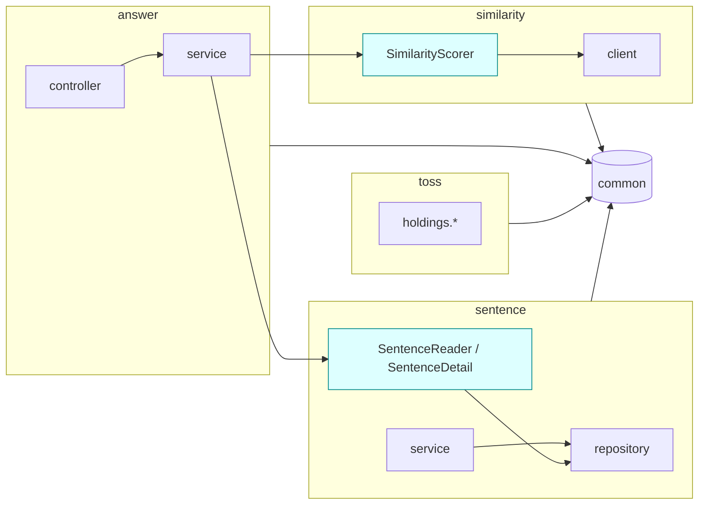

# 아키텍처 제안 (architecture-proposal)

> 상태: **제안 — 미확정**. 결정은 [decisions-needed.md](./decisions-needed.md) **D1**.
> 입력: [current-state.md](./current-state.md) (사실), [research.md](./research.md) (외부 근거).
> 비교용 예시 코드: [examples/answer-scoring/](./examples/answer-scoring/README.md) — 같은 "답안 채점" 기능을 선택지별로 재구성.
> 개정: Round 1 리뷰([reviews/architecture-proposal-round-1.md](./reviews/architecture-proposal-round-1.md)) 반영 — 단계 계획(C1), 바꾸는 기존 규칙(C2), A′ 재정의(M2), Modulith(M1), 비용 근거(M4), R5·C 트리(M5·M6), 경미 전부.
> 개정: Round 2 리뷰([reviews/architecture-proposal-round-2.md](./reviews/architecture-proposal-round-2.md)) 반영 — B 추천 근거를 "공개 표면의 크기·diff 가시성" 으로 좁힘(C1), F1T·DOC 단계(M1), 문서 목록(M2), 관찰 가능한 클라이언트 배치 규칙·Toss auth(M3), 산정식(M4).
> 개정: Round 3 리뷰([reviews/architecture-proposal-round-3.md](./reviews/architecture-proposal-round-3.md)) 반영 — A′ 규칙 (b) 를 Toss 에도 성립하도록 재작성하고 "A′ 2개 / B 1개" 로 정정(M1), C 트리를 예시와 맞춤, §0 표 위치 보강, 산정 하한, 경미 11건.

---

## 0. 한 줄 결론

**선택지 B (기능 모듈 + 공개 API, 모듈 내부는 기존 레이어드)** 를 추천한다. 단 공정하게 정의한 A(**A′**, §2)와의 차이는 좁다. B 의 순이득은 세 가지다 — (i) 공개 표면이 타 기능 `service`·`dto` **패키지 전체**가 아니라 base package 에 **골라 둔 타입**으로 좁고, 공개 범위를 넓히려면 파일을 base package 로 옮기는 diff 가 생겨 리뷰에서 드러난다 (ii) 경계 규칙이 1개(R2)로 외부 클라이언트 우회까지 막는다 — A′ 는 2개 (iii) Spring Modulith 기본 규칙과 같아 어노테이션이 덜 든다. 비용은 02 §3.2·§5.1·05 §1.3·06 §6.5 규칙 변경과 약 4파일. 결정 기준은 §3.3.

바꾸는 기존 규칙 (D1 결정 범위에 포함):

| 기존 결정 | A′ | B | C |
|---|---|---|---|
| 02 §2.2 레이어드 유지 (헥사고날에서 전환) | 유지 | 유지 | **뒤집음** |
| 02 §3.2 · 05 §1.3 외부 클라이언트는 `infra/{시스템}/` | 유지 | **변경** — 외부 시스템 = 모듈 또는 소유 모듈의 internal | 변경 (`adapter/out`) |
| 99 §2.3 클라이언트 빈은 `common/config/RestClientConfig` 에서 등록 | **변경** | **변경** | 변경 |
| 02 §5.1 (Similarity 클라이언트 위치) · 06 §6.5 (`infra/` 외부 예외) | 유지 | **변경** | 변경 |
| 02 §4.2 채점 시퀀스 3·4단계 (`SentenceRepository.findById`, `SimilarityClient.score` 직접 호출) | **변경** | **변경** | 변경 |
| 02 §3.1 패키지 트리 (`infra/`) · 99 §1 트리 (`RestClientConfig`) | 99 §1 변경 | **둘 다 변경** | 둘 다 변경 |
| 05 §1.3 기능 간 의존 규칙 (명시 없음) | 신설 — 타 기능의 `repository`·`domain`·`exception` 접근 금지 + `infra/{시스템}` 진입점 규칙 | 신설 — 타 모듈은 base package 로만 | 신설 — 포트로만 |

---

## 1. 결정해야 하는 문제

| # | 문제 | 근거 (current-state.md) | 구조로 풀어야 하는 이유 |
|---|---|---|---|
| P1 | 기능 간 경계가 없다 — `answer` 가 `sentence` 의 리포지토리·엔티티·예외를 직접 사용 | §2, §3.5, ArchUnit R2 위반 중 `answer→sentence.*` 10건 (§6.1) | 규칙만으로는 재발. 기능이 늘면(Toss, 향후 이력·사용자) 결합이 증가 |
| P2 | 외부 시스템 클라이언트 배치 규칙이 둘 | §3.6 (`infra/similarity` vs WIP `toss/holdings/infra`) | Toss 구현이 진행 중 — 지금 정하지 않으면 두 규칙이 굳는다 |
| P3 | `common` 이 구체 기능에 의존 → `common ↔ infra` 순환 | §2, ArchUnit R1·R3 | 99 §2.3 설계의 직접 결과. 외부 시스템 추가마다 `common` 수정 |
| P4 | 기능 간 데이터 전달에 엔티티 사용 | §3.2, F5 일부 (`AnswerResponse → SentenceEntity`) | 엔티티 컬럼 변경이 다른 기능의 API 계약으로 전파 |
| P5 | AI 에이전트 작업 단위를 정의할 구조적 단위가 없음 | ai-workflow.md §1 | 범위 지정("이 모듈만")을 기계 검증하려면 경계 규칙이 필요 |

**구조와 무관한 것** (conventions-proposal.md 에서 다룸): F1~F3 (기능 결함), F4 (self-invocation — R6 로 막고 FIX-F4 로 수정. B 에서는 조회가 다른 빈으로 가서 자연히 사라지지만, 어느 선택지에서도 같은 수정으로 해결된다), F5 중 "컨트롤러 vs 서비스 변환 위치 혼재" (R5, conventions §3.1).

---

## 2. 선택지

세 선택지 모두 **같은 컨벤션**(conventions-proposal.md: 서비스는 엔티티를 반환하지 않음 R5, 외부 예외 변환 클래스 1개, `@RequestBody` 등)을 적용한다고 가정한다. 차이는 구조뿐이다.

### 선택지 A′ — 레이어드 + 기능 간 접근 규칙

**구조**: 지금과 같다. `{기능}/{controller,service,repository,domain,dto,exception}` + `infra/{외부시스템}` + `common`.
**바뀌는 규칙**: (1) 다른 기능의 `repository`·`domain`·`exception` 패키지 접근 금지 — 타 기능은 그 기능의 `service` 와 `dto` 만 사용 (2) 클라이언트 빈 등록은 `infra/{시스템}/` 안의 설정 클래스로 (3) 외부 예외 변환은 `infra/{시스템}/` 의 클래스 1개 (`SimilarityScorer`).

```
com.tmi.core
├── sentence/{controller,service,repository,domain,dto,exception}
│      service/SentenceService.getActive(id) → dto/SentenceDetail (record)
├── answer/{controller,service,domain,dto}
├── infra/
│   ├── similarity/{SimilarityClient, SimilarityScorer, SimilarityClientConfig, dto/, exception/}
│   └── toss/{TossAuthClient, TossTokenProvider, TossHoldingsClient, TossHoldingsFetcher, TossClientConfig, dto/}   ← WIP 위치 변경, 00_인증.md §4
├── toss/holdings/{service,repository,domain}
└── common/{config,domain,exception}
```

- 강제 규칙 (ArchUnit, 미구현 — A′ 선택 시 R2 를 **조건 2개**로 교체):
  - (a) 기능 간 — 의존 대상이 다른 기능 모듈(`moduleOf` 기준, `common`·`infra` 제외)의 `repository`·`domain`·`exception` 패키지이면 위반. 패키지 깊이와 무관하게 판정(`..repository..` 형태 — `toss.holdings.repository` 도 보호). 기능 쌍을 열거하지 않는 조건 1개. exception 포함형으로 A′ 적용 코드 통과·AS-IS 10건 탐지 (round-3 리뷰 실행 1·2 [실행·리뷰]; round-2 의 exception 제외형은 9건).
  - (b) `infra` 진입점 — `infra/{시스템}` 안의 HTTP Interface(`@HttpExchange` 계열 메서드 보유 타입)·`dto`·`*Config`·`*AuthClient` 는 **같은 `infra/{시스템}` 패키지 안에서만** 참조. 밖에서는 시스템별 진입점만: Similarity = `SimilarityScorer`, Toss = `TossHoldingsFetcher`(재시도·예외 분류 포함, conventions §4.3)·`TossTokenProvider`. 없으면 다른 기능이 `SimilarityClient` 를 직접 주입해 예외 변환을 건너뛸 수 있다 (examples-round-2 M3). B 는 클라이언트가 모듈 internal 이라 R2 하나로 같은 효과.
  - A′ 비용에 Toss 진입점 클래스(`TossHoldingsFetcher`) 1개가 추가된다 — Toss WIP 완성(D9) 시점의 비용이라 §3.2 의 Similarity 기준 8파일에는 넣지 않았다.
- 예시: [examples/answer-scoring/option-a-layered/](./examples/answer-scoring/option-a-layered/)

### 선택지 B — 기능 모듈 + 공개 API (추천)

**구조**: `com.tmi.core` 직속 패키지 하나 = 모듈 하나. 모듈의 **base package 에 있는 타입만 공개 API**, 하위 패키지는 internal. 모듈 내부는 기존 레이어드 그대로. `infra/` 는 해체한다.

**외부 시스템 클라이언트 배치 규칙** (P2 해법, 관찰 가능한 조건만): 클라이언트는 **현재 호출하는 모듈이 1개이면 그 모듈의 internal**, **2개 이상이 되면 독립 모듈로 승격**(별도 feature_list 항목). Similarity 는 호출 모듈이 `answer` 1개지만 예외로 **지금 독립 모듈**로 둔다 — 이유: 02 §1 이 별도 서비스(`project-tmi-similarity`)로 정의한 시스템 경계이고, `answer` 안에 두면 나중에 승격할 때 패키지 이동이 한 번 더 생긴다. Toss 는 `toss` 모듈의 internal 이며, 00_인증.md §4 의 분리(인증 공통 ↔ 도메인 클라이언트)를 따라 `toss/auth/`(`TossAuthClient`, `TossTokenProvider`)와 `toss/holdings/client/`(`TossHoldingsClient`)로 나눈다.

```
com.tmi.core
├── sentence/
│   ├── SentenceReader            ← 공개 API
│   ├── SentenceDetail            ← 공개 record (엔티티 대신 노출)
│   └── controller/ service/ repository/ domain/ dto/ exception/   ← internal
├── answer/
│   └── controller/ service/ domain/ dto/                           ← internal (공개 API 없음)
├── similarity/                   ← 기존 infra.similarity 를 모듈로 승격
│   ├── SimilarityScorer          ← 공개 API (예외 변환 포함)
│   └── client/ config/ exception/   ← internal
├── toss/
│   ├── auth/{TossAuthClient, TossTokenProvider}                    ← internal (00_인증.md §4)
│   └── holdings/{client,service,repository,domain,dto}             ← internal
└── common/{config,domain,exception}                                 ← 공유 커널 (모든 모듈이 사용 가능)
```



- 모듈 간 화살표는 **공개 API(청록색)로만** 들어간다. 강제: ArchUnit R2 (구현됨, §5).
- `common` = 공유 커널: 모든 모듈이 의존 가능, `common` 은 어떤 모듈에도 의존 불가 (R3).
- 예시: [examples/answer-scoring/option-b-modular/](./examples/answer-scoring/option-b-modular/)

### 선택지 C — 기능별 헥사고날 (Ports & Adapters)

**구조**: 기능마다 `domain/model`(순수 Java), `application/port/{in,out}`, `application/service`, `adapter/{in/web, out/...}`. JPA 엔티티와 도메인 모델 분리 + 매퍼. 아래 트리 중 `answer` 흐름에 필요한 부분이 examples 와 같다 (`sentence` 의 도메인 모델·매퍼는 sentence 자체 유스케이스용이라 예시에는 없음 — 예시 어댑터는 JPA 엔티티를 포트 record 로 바로 매핑):

```
com.tmi.core.answer
├── domain/          AnswerScore, Grade
├── exception/       AnswerException.SentenceNotFound   ← answer 소유 예외 (sentence 예외 import 제거)
├── application/
│   ├── port/in/     ScoreAnswerUseCase
│   ├── port/out/    LoadSentencePort, ScoreSimilarityPort        ← answer 가 필요한 것을 answer 가 정의
│   └── service/     ScoreAnswerService
└── adapter/
    ├── in/web/      AnswerController, 웹 DTO
    └── out/similarity/  SimilarityHttpAdapter, SimilarityClient
com.tmi.core.sentence
├── domain/          Sentence (순수 모델)
└── adapter/out/persistence/  SentencePersistenceAdapter implements answer 의 LoadSentencePort,
                              SentenceJpaEntity, SentenceJpaRepository
```

- 포트 반환 타입이 중요하다: 포트가 `sentence.domain` 타입을 반환하면 `answer ↔ sentence` 순환이 된다. 예시는 포트가 answer 소유 record(`SentenceForScoring`)를 반환해 의존이 sentence(어댑터) → answer(포트) 단방향이다 — worktree 에서 컴파일·R1 순환 없음을 확인 (examples README §0).
- 대신 C 는 R2 를 "포트 패키지만 모듈 간 교차 허용" 하는 C 전용 경계 규칙으로, R4 도 어댑터·애플리케이션 레이어를 정의한 C 용 레이어 규칙으로 교체해야 한다 (현재 R4 는 어댑터 패키지가 어느 레이어에도 속하지 않아 통과할 뿐 — examples-round-3 m7) (R2 위반 3건 = 어댑터 → 포트, 헥사고날의 정상 방향).
- 예시: [examples/answer-scoring/option-c-hexagonal/](./examples/answer-scoring/option-c-hexagonal/)
- 02 §2.2 에서 **이미 한 번 도입했다가 되돌린** 구조다.

---

## 3. 비교

### 3.1 장단점

| 기준 | A′ 레이어드 + 접근 규칙 | B 기능 모듈 + 공개 API | C 헥사고날 |
|---|---|---|---|
| P1 기능 간 결합 | 해결 — repository·domain·exception 차단. 단 타 기능의 **모든** service·dto 가 노출 (웹 응답 DTO 도 재사용 가능) | 해결 — base package 에 둔 타입만 노출. 넓히려면 파일 이동 diff 가 필요 | 해결 — 포트로만 |
| P2 외부 클라이언트 배치 | 해결 (`infra/` 일원화, 02 §3.2 유지) | 해결 (§2 B 배치 규칙 — 02 §3.2 변경) | 해결 (`adapter/out`) |
| P3 `common` 역방향 의존 | 해결 | 해결 | 해결 |
| P4 기능 간 엔티티 전달 | 해결 (R5 + `sentence.dto.SentenceDetail`) | 해결 (공개 record) | 해결 (포트 소유 record `SentenceForScoring`) |
| P5 AI 작업 단위 | 기능 패키지. 경계 규칙 **2개** (A′ (a) 기능 간 + (b) infra 진입점, §2) | 모듈. 경계 규칙 **1개** (R2 — 모듈 internal 이 둘 다 커버) | 유스케이스 (가장 세밀). C 전용 경계 규칙 필요 (R2·R4 교체) |
| 공개 범위의 명시성 | 암묵 — "service 와 dto 는 공개" | 명시 — 파일 위치가 곧 공개 여부 | 명시 — 포트 |
| 포트 소유·어댑터 위치 문제 | 없음 | 없음 | 있음 — 포트 반환 타입을 잘못 고르면 순환. answer 소유 record 로 해결(+1 타입), C 전용 경계 규칙 필요 (§2 C) |
| 도메인 순수성 | 낮음 (엔티티 = 도메인) | 낮음 | **높음** |
| 파일 수 (§3.2) | 약 8 | 약 12 | 약 23 수정 + 20 이상 신규 |
| 팀 기존 결정 (§0 표) | 99 §2.3, 02 §4.2 변경 | + 02 §3.2·§5.1·05 §1.3·06 §6.5 변경 | 02 §2.2 포함 전부 변경 |
| Spring Modulith 로의 확장 | 재배치 없이 가능 — 공개할 `service`·`dto` 패키지마다 `package-info.java` + `@NamedInterface` (기능당 1~2파일) | `common` 을 OPEN 모듈로 선언 (1파일) (§4.1-5) | 무관 |

### 3.2 마이그레이션 비용

**계수 기준**: `src/main` 파일 단위, 신규·수정·이동·삭제를 각 1로 센다. F1(`@RequestBody`) 등 구조와 무관한 수정과 **테스트 파일**(B 의 테스트 패키지 이동 1~3파일, A′ 의 ArchUnit R2 교체 1~2파일)은 제외 — 양쪽 다 비슷해 결론에 영향 없음. 시간 산정식: 파일당 구현 15~20분 + PR 당 리뷰 1회(약 1시간) + 가산 요인. (estimated)

| 선택지 | 파일 목록 | 합계 | 소요 (estimated) |
|---|---|---|---|
| A′ | 신규 `infra/similarity/SimilarityClientConfig`, `infra/similarity/SimilarityScorer`, `sentence/dto/SentenceDetail` · 수정 `common/config/RestClientConfig`(→삭제), `sentence/service/SentenceService`(`getActive` 추가), `answer/service/AnswerService`, `answer/dto/AnswerResponse`, `application.properties`(`similarity.*` 키) | **8** | 8×15~20분 ≈ 2~2.7h + 리뷰 1회 → **0.5일** |
| B | 신규 `sentence/SentenceReader`, `sentence/SentenceDetail`, `similarity/SimilarityScorer`, `similarity/config/SimilarityClientConfig` · 이동 `SimilarityClient`→`similarity/client/`(dto 2개 흡수 → `SimilarityRequest`·`SimilarityResponse` 삭제 2), `SimilarityException`→`similarity/exception/` · 삭제 `common/config/RestClientConfig` · 수정 `AnswerService`, `AnswerResponse`, `application.properties` | **12** | 12×15~20분 ≈ 3~4h + 리뷰 2회(B2·B3, 약 2h) + `git mv` 단독 커밋 + B2 의 plan gate 대기 → **약 1일** |
| C | 기존 수정·이동 최대 23 (`src/main` 34 − `common` 10 − `CoreApplication` 1) + 신규: `answer` 포트 3·서비스 1·도메인 1, `sentence` 도메인 모델 1·어댑터 1·매퍼 1, 웹 DTO 이동, Similarity 어댑터 1 … (examples C 기준 한 흐름에 신규 7 + 수정 1) | **약 23 + 20 이상** | 42+×15~20분 ≈ 10.5~14h + 엔티티·도메인 분리에 따른 테스트 재작성 + 02·05·06 전면 개정 → **2~3일** |

- B 의 `SimilarityRequest`·`SimilarityResponse` 는 `SimilarityClient` 에 중첩 record 로 흡수하는 예시를 따랐다 — 흡수하면 이 두 파일은 `git mv` 로 blame 을 유지할 수 없다. 별도 파일로 이동만 하면 합계는 같고 blame 은 유지된다.
- 파일 목록 상세: [examples/answer-scoring/README.md §3](./examples/answer-scoring/README.md#3-파일-목록과-비교).
- 기존 문서 수정 (§0 표): A′ = 99 §2.3, 02 §4.2, 05 §1.3 (기능 간 규칙 신설). B = 위 + 02 §3.1 트리·§3.2·§5.1, 06 §6.5. C = 02·05·06 전면. 담당: `DOC-1`(구조 무관분) + `DOC-2`(D1 결정분, feature_list `pending_decision`).

### 3.3 무엇으로 고를까

| 이 질문에 | "예" 이면 |
|---|---|
| `answer` 같은 다른 기능이 `sentence` 의 웹 응답 DTO·서비스 전체를 써도 괜찮은가? | A′ 로 충분 |
| 기능이 3개 이상으로 늘고(Toss 진행 중, 01 기획 §4.2 의 이력·사용자), 모듈마다 "여기만 공개" 를 파일 위치로 강제하고 싶은가? | **B** |
| `infra/` 를 유지하는 기존 규칙(02 §3.2)을 바꾸고 싶지 않은가? | A′ |
| Similarity·Toss 를 다른 구현으로 갈아끼울 계획이 실제로 있는가? | C 검토 — 현재 문서(01 기획, toss 설계)에 그런 계획 없음 |

---

## 4. 추천: 선택지 B

### 4.1 근거

1. **공개 표면이 좁고, 넓히면 diff 로 드러난다.** A′ 도 결합을 막지만 "타 기능의 `service`·`dto` 패키지는 전부 공개" 다. `sentence.dto.SentenceResponse`(웹 응답)를 `answer` 가 재사용해도 규칙 위반이 아니고, 그 순간 웹 계약과 기능 간 계약이 묶인다. B 에서도 같은 결합은 가능하지만(§4.2 마지막 행) **`SentenceResponse` 를 base package 로 옮기거나 공개 API 가 웹 DTO 를 반환하는 변경이 diff 로 보여야** 한다 — 리뷰 체크리스트 한 줄로 잡힌다. 규칙 개수는 A′ 2개((a)+(b)), B 1개(R2) — round-2 리뷰 C1 의 "둘 다 1개" 는 (b) 추가 전 기준이었다 (round-3 M1).
2. **Toss 배치 문제(P2)를 지금 결정한다.** WIP 의 `toss.holdings.infra.TossHoldingsClient` 는 B 의 `toss.holdings.client` 로 거의 그대로 간다 (`docs/ai/wip-snapshot.patch`). 단 WIP 는 그 빈을 `common/config/RestClientConfig` 에 등록하므로 R3 와 반대 방향이기도 하다 — WIP 가 B 를 "지지" 하는 근거는 절반이다.
3. **비용 차이가 작다.** A′ 대비 약 4파일 (주로 `infra.similarity` 패키지 이동), 시간 차 약 0.5일 (§3.2). 이동은 `git mv` 단독 커밋으로 분리 가능.
- 참고 (A′·B 공통 — B 만의 근거 아님): 헥사고날의 이득 중 필요한 것(외부 HTTP 경계 격리)은 `SimilarityScorer` 클래스 하나로 A′·B 모두 얻는다.
4. **Spring Modulith 와 규칙이 같다 — `common` 처리만 다르다.** Modulith 2.0.8 소스 확인 [J] (round-1 리뷰 M1, `spring-modulith-core-2.0.8-sources.jar` 의 `ApplicationModuleDetectionStrategy`·`NamedInterfaces.discoverNamedInterfaces`·`ApplicationModule.isValidDependencyWithin`, OPEN 지정은 `ApplicationModuleInformationFactory`): 직속 하위 패키지 = 모듈(`directSubPackage`), base package = 공개(unnamed named-interface 가 하위 패키지 제외). 다만 Modulith 에는 "공유 커널" 예외가 없어, 지금 상태로는 `common.exception.BaseException` 등을 쓰는 모든 모듈이 위반이 된다. `common` 에 `@ApplicationModule(type = Type.OPEN)` (`package-info.java` 1파일)을 두면 같은 규칙이 된다. 그 외 차이(이벤트, 문서화 등)는 미검증. A′ 도 `@NamedInterface` 로 표현 가능하나 기능당 1~2파일이 든다 (§3.1).

### 4.2 추천안의 약점 (승인 전 알아야 할 것)

| 약점 | 영향 | 완화 |
|---|---|---|
| 02 §3.2·§5.1·05 §1.3·06 §6.5 의 `infra/` 규칙을 뒤집는다 | 기존 문서 4곳 + (A′ 와 공통) 99 §2.3·02 §4.2 | `DOC-2` (D1 결정 후) |
| `SentenceDetail` 이 엔티티 필드 일부를 복제 | 파일 +1, 매핑 몇 줄 | 호출 측이 쓰는 필드만 (`id`, `englishText`, `koreanRef`). A′ 도 같은 record 가 필요 |
| internal 예외(`SentenceException.NotFound`)가 공개 API 를 통해 밖으로 던져짐 | 예외 타입이 경계를 넘음 | 호출 측은 catch 하지 않고 `GlobalExceptionHandler` 가 `BaseException` 으로 처리 (`GlobalExceptionHandler.java:25`) |
| 패키지 이동으로 git blame 이 끊길 수 있음 | `infra.similarity` 4파일 (6타입) | `git mv` 단독 커밋, dto 는 흡수 대신 이동 선택 가능 (§3.2) |
| base package 에 아무 클래스나 두면 공개됨 | 규칙을 모르는 사람이 공개 범위를 넓힘 | CLAUDE.md 명시 + 리뷰 체크리스트 (ai-workflow.md §3) |

### 4.3 단계적 실행 계획 (feature_list.example.json 과 1:1)

| 단계 | 항목 id | 내용 | 완료 신호 | depends_on |
|---|---|---|---|---|
| 0 (구조 무관) | `TEST-1` → `FIX-F1`, `FIX-F2` | DB 없는 테스트 + F1·F2 | 각 테스트의 `@Disabled` 제거 후 통과, R7 해제 | — / TEST-1 |
| 0 | `FIX-F1T` | read timeout·빈 응답 → 503 (`AnswerService` 에 catch·null 처리) | `SimilarityTimeoutTest` | FIX-F1 |
| 0 | `SIG-1`, `SIG-2` | 테스트 기본 신호, 포맷 | DB 차단 상태에서 `test` 통과 / `spotlessCheck` 0 | — / — |
| 0 | `FIX-F3` | 예외 핸들러 | 깨진 JSON 400 등 테스트 | FIX-F2, SIG-2 |
| 0 | `FIX-R5` → `FIX-F4` | 서비스 DTO 반환 → self-invocation 제거 + OSIV off | **R5 해제 → R6 해제**, `OsivConnectionIT` | TEST-1 / FIX-R5, SIG-1 |
| 1 (A′·B 공통) | `ARCH-A1` | Similarity 빈 설정을 `common` 밖(`infra.similarity`)으로 | **R1·R3 해제** (round-1 리뷰가 실제 이동 후 통과를 실행 확인) | FIX-F1 |
| 0 | `DOC-1` | 05/06/99/03 수정 (구조 무관분) | 사람 판정 | FIX-F3, FIX-F4 |
| 2-B (D1=B) | `ARCH-B2` → `ARCH-B3` → `DOC-2` | `similarity` 모듈 승격(F1T 의 catch 를 `SimilarityScorer` 로 이동) → `SentenceReader`/`SentenceDetail` → 02·05·06 구조 문서 | `infra` 패키지 소멸 → **R2 해제** → 사람 판정 | ARCH-A1, **FIX-F1T**, SIG-1 / ARCH-B2 / ARCH-B3 |
| 2-A′ (D1=A′) | `ARCH-A2` → `DOC-2` | `SentenceService.getActive → SentenceDetail`, `SimilarityScorer` 도입(F1T 의 catch 이동), R2 를 A′ 규칙 (a)(b) 로 교체 → 02·05·99 문서 | A′ 규칙 통과 → 사람 판정 | ARCH-A1, **FIX-F1T** / ARCH-A2 |
| 3 | (D9 결정 후 등록) | Toss WIP 를 선택된 배치로 완성 | ArchUnit 전체 통과 | ARCH-B3 또는 ARCH-A2 |

- 단계 1 까지는 어느 선택지든 **버려지는 작업이 없다** (`ARCH-A1` 의 `SimilarityClientConfig` 는 B 에서 `git mv` + 몇 줄 수정 — 패키지·import·가시성).
- 2-B 와 2-A′ 는 `feature_list.example.json` 의 `pending_decision` 에 있다 — D1 결정 후 하나만 `items` 로 옮긴다.

---

## 5. 추천안의 검증 규칙 (ArchUnit)

`src/test/java/com/tmi/core/architecture/` 에 구현하고 실행했다. 결과(위반 목록·오탐 점검)는 [current-state.md §6](./current-state.md#6-archunit-위반-목록).

| ID | 규칙 | 구현 범위·한계 | 막는 문제 | 현재 |
|---|---|---|---|---|
| R1 | 모듈(직속 패키지) 사이 순환 의존 금지 | `slices().matching("com.tmi.core.(*)..")` | P3 | 위반 1 → `ARCH-A1` |
| R2 | 다른 모듈의 하위 패키지 접근 금지 (base package 만, `common` 예외) | `common` 출발 의존은 R3 가 담당 | P1 | 위반 19 (= 현행 규칙으로도 문제 10 + B 기준 9) → `ARCH-B2`·`B3` (A′ 면 규칙 교체) |
| R3 | `common` 은 기능 모듈에 의존 금지 | | P3 | 위반 2 → `ARCH-A1` |
| R4 | 모듈 내부 레이어: controller → service → repository | Service 레이어 = `..service..` 또는 `@Service` (B 의 공개 API 포함) | 레이어 붕괴 | 통과 |
| R4b | `domain` → controller·service·repository·dto 금지 | | WIP 의 `domain → dto` (D9) | 통과 |
| R5 | `@Service` public 메서드는 `@Entity` 를 반환하지 않는다 | 제네릭 인자까지 검사 (`Optional<E>`, `List<E>`) | P4, OSIV 의존 | 위반 1 → `FIX-R5` |
| R6 | `@Transactional` 메서드를 같은 클래스 안에서 호출 금지 | 메서드 레벨 Spring `@Transactional` 만. 클래스 레벨·`jakarta.transaction.Transactional` 은 미검사 | F4 재발 | 위반 1 → `FIX-F4` |
| R7 | HTTP Interface 메서드의 **모든** 파라미터에 바인딩 어노테이션 | 예외 타입 `URI`·`HttpMethod`·`UriBuilderFactory` (estimated) | F1 재발 | 위반 1 → `FIX-F1` |

R5~R7 은 컨벤션 성격이지만 기계 검증이 가능해서 함께 둔다 (conventions-proposal.md 와 연결). 오탐 점검: 선택지 B 형태의 임시 픽스처로 R2·R5 위반 0, 위반 형태로 탐지 확인 (current-state.md §6.3).

---

## 6. 선택하지 않을 때의 비용

| 결정 지연 | 결과 |
|---|---|
| 아무것도 정하지 않음 | Toss WIP 가 `toss.holdings.infra` + `common/config` 등록으로 커밋 → 외부 클라이언트 규칙 2개 고착 (P2), `common ↔ toss` 순환 추가 |
| 단계 1(`ARCH-A1`)까지만 | P3 해결. P1·P4 는 남지만 이후 A′·B 어느 쪽으로도 갈 수 있다 |
