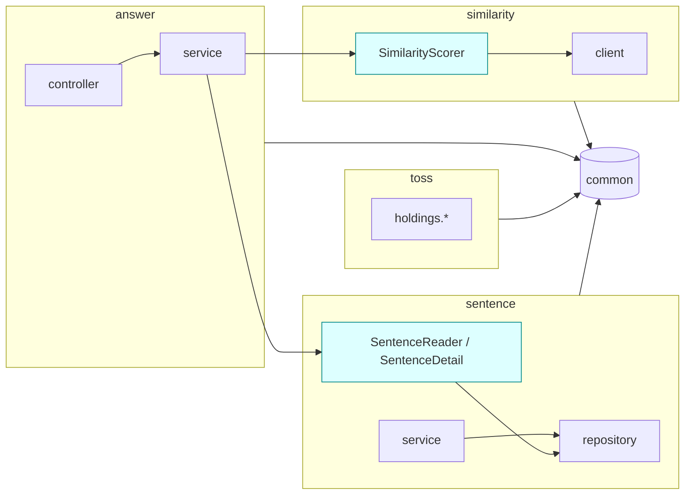

# 아키텍처 제안 (architecture-proposal)

> 상태: **제안 — 미확정**. 결정은 [decisions-needed.md](./decisions-needed.md) **D1**.
> 입력: [current-state.md](./current-state.md) (사실), [research.md](./research.md) (외부 근거).
> 비교용 예시 코드: [examples/answer-scoring/](./examples/answer-scoring/README.md) — 같은 "답안 채점" 기능을 세 선택지로 재구성.

---

## 0. 한 줄 결론

**선택지 B (기능 모듈 + 공개 API, 모듈 내부는 기존 레이어드)** 를 추천한다. 기존 팀 결정(02 §2.2 "헥사고날 → 레이어드")을 뒤집지 않으면서, 현재 결함 F5·F6·F7 을 구조로 막고, AI 에이전트에게 "이 모듈만 수정" 이라는 작업 단위를 줄 수 있는 가장 싼 방법이기 때문이다.

---

## 1. 결정해야 하는 문제

현재 코드에서 구조 때문에 생긴 문제만 추렸다 (기능 버그 F1~F3 은 구조와 무관 — conventions-proposal.md 에서 다룸).

| # | 문제 | 근거 (current-state.md) | 구조로 풀어야 하는 이유 |
|---|---|---|---|
| P1 | 기능 간 경계가 없다 — `answer` 가 `sentence` 의 리포지토리·엔티티·예외를 직접 사용 | §2, §3.5, `AnswerService.java:24,37-38` | 규칙만으로는 재발. 도메인이 늘면 (Toss, 향후 이력·사용자) 결합이 기하급수로 증가 |
| P2 | 외부 시스템 클라이언트 배치 규칙이 둘 | §3.6 (`infra/similarity` vs WIP `toss/holdings/infra`) | Toss 구현이 진행 중 — **지금 정하지 않으면 두 규칙이 굳는다** |
| P3 | `common` 이 구체 기능(`infra.similarity`)에 의존 | §2, `RestClientConfig.java:3` | 외부 시스템 추가마다 `common` 수정 → 공통 모듈이 변경 허브가 됨 |
| P4 | DTO 변환·트랜잭션 경계의 위치가 기능마다 다름 | §3.2, §3.4 | 경계가 정의돼야 "어디서 변환하고 어디서 트랜잭션을 여는가" 가 정해짐 |
| P5 | AI 에이전트 작업 단위를 정의할 구조적 단위가 없음 | ai-workflow.md §1 | "sentence 모듈만 수정" 같은 범위 지정은 모듈 경계가 있어야 검증 가능 |

---

## 2. 선택지

### 선택지 A — 현행 레이어드 유지 + 규칙 정비

**구조**: 지금과 같다. `{기능}/{controller,service,repository,domain,dto,exception}` + `infra/{외부시스템}` + `common`.
**바뀌는 규칙**: 기능 간 호출은 **상대 기능의 Service 를 통해서만** (리포지토리 직접 접근 금지). 클라이언트 빈 등록은 `infra/{시스템}/` 안의 설정 클래스로 이동.

```
com.tmi.core
├── sentence/{controller,service,repository,domain,dto,exception}
├── answer/{controller,service,domain,dto}
├── infra/
│   ├── similarity/{SimilarityClient, SimilarityClientConfig, dto/, exception/}
│   └── toss/{TossHoldingsClient, TossClientConfig, dto/}        ← WIP 위치 변경
├── toss/holdings/{service,repository,domain}                      ← 스케줄러·저장
└── common/{config,domain,exception}
```

- 예시: [examples/answer-scoring/option-a-layered/](./examples/answer-scoring/option-a-layered/)
- `AnswerService` 는 `SentenceService.getActive(id)` 를 호출. 반환 타입은 여전히 `SentenceEntity` (기능 간 엔티티 공유 허용).

### 선택지 B — 기능 모듈 + 공개 API (추천)

**구조**: `com.tmi.core` 직속 패키지 하나 = 모듈 하나. 모듈의 **base package 에 있는 타입만 공개 API**, 하위 패키지는 모듈 내부(internal). 모듈 내부는 기존 레이어드 그대로. Spring Modulith 의 기본 규칙과 같은 모양이다 (research.md §1.2) — 단 Modulith 의존성 없이 ArchUnit 으로 강제한다.

```
com.tmi.core
├── sentence/
│   ├── SentenceReader            ← 공개 API (타 모듈용 조회)
│   ├── SentenceDetail            ← 공개 record (엔티티 대신 노출)
│   └── controller/ service/ repository/ domain/ dto/ exception/   ← internal
├── answer/
│   └── controller/ service/ domain/ dto/                           ← internal (공개 API 없음)
├── similarity/                   ← 기존 infra.similarity 를 모듈로 승격
│   ├── SimilarityScorer          ← 공개 API (예외 변환 포함)
│   └── client/ config/           ← internal (HTTP Interface, 요청·응답 record, 빈 등록)
├── toss/
│   └── holdings/{client,service,repository,domain,dto}             ← internal (공개 API 없음)
└── common/{config,domain,exception}                                 ← 공유 커널 (모든 모듈이 사용 가능)
```



- 예시: [examples/answer-scoring/option-b-modular/](./examples/answer-scoring/option-b-modular/)
- 모듈 간 화살표는 **공개 API(청록색)로만** 들어간다. `answer → sentence.repository` 같은 화살표는 ArchUnit 이 빌드에서 막는다 (§5).
- `common` 은 "공유 커널": 모든 모듈이 의존 가능, `common` 은 어떤 모듈에도 의존 불가.

### 선택지 C — 기능별 헥사고날 (Ports & Adapters)

**구조**: 기능마다 `domain/model`(순수 Java), `application/port/{in,out}`, `application/service`, `adapter/{in/web, out/persistence, out/similarity}`. JPA 엔티티와 도메인 모델 분리 + 매퍼.

```
com.tmi.core.answer
├── domain/          AnswerScore, Grade                      (프레임워크 의존 0)
├── application/
│   ├── port/in/     ScoreAnswerUseCase, ScoreAnswerCommand
│   ├── port/out/    LoadSentencePort, ScoreSimilarityPort
│   └── service/     ScoreAnswerService
└── adapter/
    ├── in/web/      AnswerController, AnswerApi, 요청·응답 DTO
    └── out/
        ├── persistence/  SentencePersistenceAdapter, SentenceJpaEntity, SentenceMapper
        └── similarity/   SimilarityHttpAdapter, SimilarityClient, dto
```

- 예시: [examples/answer-scoring/option-c-hexagonal/](./examples/answer-scoring/option-c-hexagonal/)
- 02 §2.2 에서 **이미 한 번 도입했다가 되돌린** 구조다.

---

## 3. 비교

### 3.1 장단점

| 기준 | A. 레이어드 정비 | B. 기능 모듈 + 공개 API | C. 헥사고날 |
|---|---|---|---|
| P1 기능 간 결합 | 부분 해결 — 리포지토리 접근은 막지만 **엔티티 공유는 남음** | **해결** — 공개 record 만 공유 | 해결 — 포트로만 접근 |
| P2 외부 클라이언트 배치 | 해결 (`infra/` 일원화) | 해결 (외부 시스템 = 모듈, 클라이언트는 internal) | 해결 (`adapter/out`) |
| P3 `common` 역방향 의존 | 해결 | 해결 | 해결 |
| P4 DTO·트랜잭션 경계 | 규칙으로만 (위반 감지 일부) | 공개 API = 경계 → **타 모듈엔 엔티티가 못 나감** | 포트 = 경계 |
| P5 AI 작업 단위 | 기능 패키지 단위, 경계 검증 약함 | **모듈 단위**, ArchUnit 이 경계 위반을 빌드 실패로 알림 | 유스케이스 단위 (가장 세밀) |
| 도메인 순수성 | 낮음 (엔티티 = 도메인) | 낮음 (동일) | **높음** (도메인 모델이 JPA 무관) |
| 파일 수 증가 | +2 (설정 클래스 분리) | +4~6 (공개 API·record·scorer) | +2~3배 (research.md §2, 02 §2.2) |
| 팀 기존 결정과의 정합 | 완전 일치 | 일치 (내부는 레이어드) | **충돌** — 되돌린 결정의 재도입 |
| Spring Modulith 로의 확장 | 패키지 재배치 필요 | **그대로 `verify()` 가능** (estimated) | 무관 |
| 학습 비용 | 없음 | "base package = 공개" 규칙 1개 | 포트·어댑터·매핑 전략 |

### 3.2 마이그레이션 비용

비용은 이 저장소 기준 **파일 단위 실측 목록**이며, 시간은 AI 에이전트 + 사람 리뷰 기준 추정이다 (estimated).

| 작업 | A | B | C |
|---|---|---|---|
| `RestClientConfig` 의 Similarity 빈을 외부 시스템 쪽 설정으로 이동 | 1파일 신규, 1파일 수정 | 동일 | 동일 (`adapter/out/similarity`) |
| `AnswerService` 의 타 기능 리포지토리 의존 제거 | `SentenceService` 에 메서드 1개 추가 | `SentenceReader` + `SentenceDetail` 2파일 신규 | `LoadSentencePort` + 어댑터 + 매퍼 + JPA 엔티티 분리 |
| `AnswerResponse.of(SentenceEntity, …)` 의 엔티티 의존 제거 | 유지 (엔티티 공유 허용) | `SentenceDetail` 로 시그니처 변경 | 도메인 모델로 변경 |
| `infra.similarity` 패키지 이동 | 없음 | 6개 타입 패키지 이동 (`SimilarityClient`, 요청·응답 record, 예외 3) + `SimilarityScorer` 신규 | `adapter/out/similarity` 로 이동 |
| Toss WIP 배치 | `infra/toss/` 로 | `toss/holdings/client/` 로 | `toss/.../adapter/out/toss/` 로 |
| `sentence` 엔티티·도메인 분리 | 없음 | 없음 | `Sentence`(도메인) + `SentenceJpaEntity` + 매퍼 3파일, `Level`/`Category` 위치 재검토 |
| 기존 문서 수정 (02, 05, 06, 99) | 05 §1.3 소폭 | 05 §1.3, 02 §3, 99 §1 | 02·05·06 전면 |
| ArchUnit 규칙 | 레이어 규칙 4개 | 레이어 4 + 모듈 경계 2 | 헥사고날 규칙 (`onionArchitecture`) |
| **변경 파일 수 (테스트 제외)** | 약 5 | 약 12 | 약 30+ (`src/main` 34파일 대부분) |
| **소요 (estimated)** | 0.5일 | 1~1.5일 | 3~5일 |
| 되돌리기 비용 | 낮음 | 낮음 (패키지 이동 위주) | 높음 |

### 3.3 이 프로젝트에서 각 선택지가 맞는 조건

| 선택지 | 이런 조건이면 고른다 |
|---|---|
| A | 기능이 `sentence`·`answer` 2개에서 더 늘지 않고, Toss 가 실험성 부가 기능으로 끝날 때 |
| **B** | Toss 처럼 **성격이 다른 기능이 계속 추가**되고(현재 진행 중), AI 에이전트에게 모듈 단위로 일을 맡기고 싶을 때 |
| C | 외부 시스템 교체가 실제로 예정돼 있거나(예: Similarity 를 다른 엔진으로), 도메인 규칙이 JPA 와 무관하게 복잡해질 때 — **현재 근거 없음** |

---

## 4. 추천: 선택지 B

### 4.1 근거

1. **현재 구조와 거리가 가장 짧다.** 모듈 내부 레이어드는 그대로이고, 바뀌는 것은 "모듈 간 출입구" 뿐이다. 변경 파일 약 12개 (§3.2).
2. **진행 중인 Toss 작업의 배치 문제(P2)를 지금 결정한다.** WIP 의 `toss.holdings.infra.TossHoldingsClient` 는 B 에서 `toss.holdings.client` 로 거의 그대로 들어간다 — 이미 "외부 클라이언트를 소유 기능 안에 둔다" 는 B 의 방향으로 가고 있다 (`docs/ai/wip-snapshot.patch`).
3. **결합 문제(P1)를 규칙이 아니라 빌드로 막는다.** A 는 "엔티티 공유 허용" 이라 `AnswerResponse → SentenceEntity` 결합(`AnswerResponse.java:30`)이 남고, 엔티티 컬럼 변경이 `answer` API 계약에 새어 나간다.
4. **헥사고날의 이득 중 이 프로젝트에 필요한 것(외부 HTTP 경계 격리)만 가져온다.** `SimilarityScorer` 는 사실상 포트 + 어댑터 한 쌍이지만 인터페이스·매퍼 없이 클래스 하나다 (research.md §2 적합성).
5. **Spring Modulith 로 이어갈 수 있다.** B 의 패키지 규칙은 Modulith 기본 탐지 규칙(직속 하위 패키지 = 모듈, 하위 = internal)과 같다 (research.md §1.2). 나중에 이벤트 발행·모듈 문서화가 필요해지면 의존성만 추가하면 된다 (estimated — 실제 `verify()` 미실행).

### 4.2 추천안의 약점 (승인 전 알아야 할 것)

| 약점 | 영향 | 완화 |
|---|---|---|
| `SentenceDetail` 같은 공개 record 가 **엔티티와 필드가 거의 같아** 중복처럼 보인다 | 파일 +1, 매핑 코드 몇 줄 | 공개 record 는 타 모듈이 실제로 쓰는 필드만 담는다 (answer 는 `id`, `englishText`, `koreanRef` 3개) |
| 모듈 내부 예외(`SentenceException.NotFound`)가 공개 API 를 통해 밖으로 던져진다 | 예외 타입이 internal 인데 경계를 넘음 | 호출 측은 catch 하지 않고 `GlobalExceptionHandler` 가 `BaseException` 으로 처리 — 타입 의존 없음. 필요해지면 공개 패키지로 이동 |
| 패키지 이동으로 git blame 이 끊긴다 | `infra.similarity` 6개 타입 | `git mv` 단독 커밋으로 분리 (`git log --follow` 유지) |
| ArchUnit 규칙이 패키지 이름 규칙에 의존 | 규칙을 모르는 사람이 base package 에 아무 클래스나 두면 공개됨 | CLAUDE.md 에 규칙 명시 + 리뷰 체크리스트 (ai-workflow.md §3) |
| Modulith 실행 검증 안 됨 | "그대로 verify 가능" 은 추정 | Modulith 도입 시점에 별도 검증. 지금은 ArchUnit 으로 같은 규칙 실행 (§5) |

### 4.3 단계적 실행 계획

B 는 A 를 포함한다. 그래서 **A 의 작업을 먼저 하고 B 로 넘어가는** 2단계로 나누면 중간에 멈춰도 손해가 없다.

| 단계 | 작업 | 완료 신호 | 의존 |
|---|---|---|---|
| 0 | 기능 결함 수정 F1 (`@RequestBody`), F2 (basename), F3 (핸들러) + 각각 테스트 | conventions-proposal.md 의 해당 테스트 통과 | 없음 — **구조 결정과 무관하게 먼저** |
| 1 (= A) | `SimilarityClientConfig` 분리, `AnswerService → SentenceService` 경유 | ArchUnit R3·R4 통과 | 0 |
| 2 (= B) | `infra.similarity` → `similarity` 모듈 이동 + `SimilarityScorer`, `SentenceReader`/`SentenceDetail` 도입 | ArchUnit R1·R2 통과 → `@Disabled` 해제 | 1 |
| 3 | Toss WIP 를 `toss.holdings.client` 에 배치해 완성 | ArchUnit 전체 통과 | 2 |

---

## 5. 추천안의 검증 규칙 (ArchUnit)

6단계에서 `src/test/java/com/tmi/core/architecture/` 에 구현하고 실행했다. 결과(위반 목록)는 [current-state.md §6](./current-state.md#6-archunit-위반-목록).

| ID | 규칙 | 막는 문제 |
|---|---|---|
| R1 | 모듈(직속 패키지) 사이 순환 의존 금지 | 구조 붕괴 |
| R2 | 다른 모듈의 **하위 패키지** 접근 금지 (base package 만 허용, `common` 예외) | P1 |
| R3 | `common` 은 어떤 기능 모듈에도 의존 금지 | P3 |
| R4 | 모듈 내부 레이어: controller → service → repository, 역방향·건너뛰기 금지 | 레이어 붕괴 |
| R5 | `@Service` 의 public 메서드는 `@Entity` 타입을 반환하지 않는다 | P4 (OSIV 의존) |
| R6 | `@Transactional` 메서드를 같은 클래스 안에서 호출 금지 | F4 재발 |
| R7 | HTTP Interface(`@HttpExchange` 계열) 메서드의 복합 타입 파라미터는 `@RequestBody` 등 바인딩 어노테이션 필수 | F1 재발 |

R5~R7 은 컨벤션 성격이지만 기계 검증이 가능해서 함께 둔다 (conventions-proposal.md 와 연결).

---

## 6. 선택하지 않을 때의 비용

| 결정 지연 | 결과 |
|---|---|
| 아무것도 정하지 않음 | Toss WIP 가 `toss.holdings.infra` 로 커밋 → 외부 클라이언트 규칙 2개 고착 (P2). `answer` 처럼 타 기능 리포지토리 직접 사용이 Toss 에도 복제될 위험 |
| A 만 선택 | 0.5일로 P2·P3 해결. P1 은 엔티티 공유로 남음 — 기능이 3개 이상이 되는 시점에 B 로 재이동 비용 발생 (패키지 이동은 그때도 비슷한 비용, estimated) |
