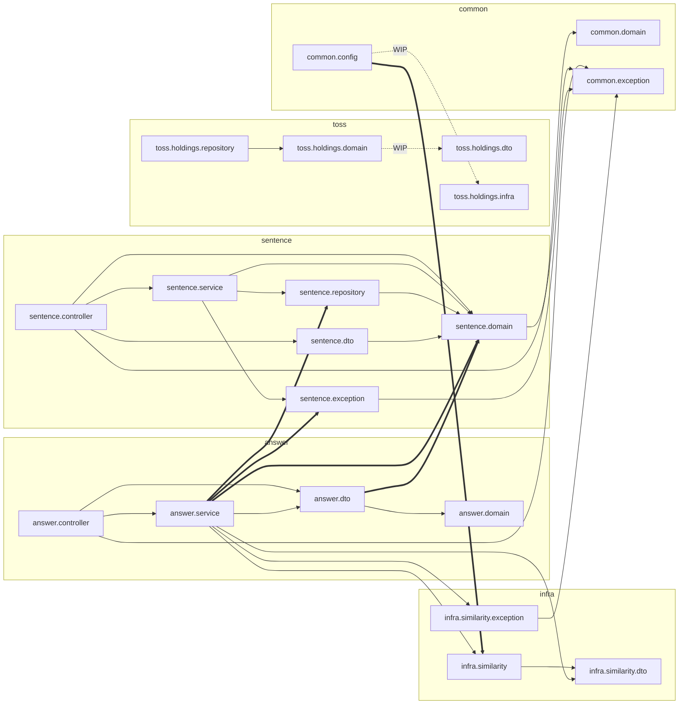

# 현재 상태 전수 분석 (current-state)

> 상태: **제안 단계 산출물** — 이 문서는 사실 기록이며 결정을 담지 않는다. 결정 항목은 [decisions-needed.md](../proposals/decisions-needed.md).
> 분석 기준: 브랜치 `claude/ai-dev-prep` 의 `src/main` (Java 34 파일, 중첩 클래스 포함 40 타입). 이 브랜치는 `src/main` 을 변경하지 않으므로 `main` HEAD `e85dba5` 와 동일하다 (`git diff e85dba5 HEAD -- src/main` 0줄).
> 개정: Round 1 리뷰([reviews/current-state-round-1.md](../reviews/current-state-round-1.md)) 반영 — OSIV 커넥션 점유(C1), `RestClient.Builder` 빈 부재, SpEL 필요성, 계약 불일치 등.
> 개정: Round 2 리뷰([reviews/current-state-round-2.md](../reviews/current-state-round-2.md)) 반영 — R2 위반 19건 분해(현행 규칙 위반 10 / B 기준 9), 규칙별 탐지 한계·음성 대조, read timeout → 500 추가.
> 개정: Round 3 리뷰([reviews/current-state-round-3.md](../reviews/current-state-round-3.md)) — 4·4·4·4. 경미 7건 반영 (FIX-F1T 연결, P7/P8 번호, 43 class 파일·바이트코드 동일, R6 jakarta 한계).
> 작업 트리에만 존재하는 미커밋 변경(WIP)은 §5 에 별도로 정리했다. 이 문서의 표는 **커밋된 코드** 기준이다.

표기 규칙

- `[정적]` 코드를 읽고 판단한 내용. 실행으로 검증하지 않음.
- `[실행]` 테스트·빌드 실행으로 확인한 내용 (§6 ArchUnit 결과, §7 빌드·프로브 결과 참조). 리뷰어가 실행해 확인한 항목은 `[실행·리뷰]` 로 표기하고 출처 리뷰 파일을 적었다.
- 경로는 `src/main/java/com/tmi/core/` 를 생략하고 `answer/service/AnswerService.java:36` 형식으로 쓴다.

---

## 0. 요약 — 결정에 영향을 주는 발견 (중요도 순)

| # | 발견 | 근거 | 검증 |
|---|---|---|---|
| F1 | `POST /api/v1/answers` 가 **항상 500** — `SimilarityClient.score` 의 `@RequestBody` 누락 | `infra/similarity/SimilarityClient.java:10`, §7.2 P8 | [실행] |
| F2 | 에러 메시지 번들이 로드되지 않아 모든 에러 `message` 가 코드 문자열, i18n 미동작. basename 만 고치면 `fallback-to-system-locale`(기본 `true`) 때문에 서버 로케일이 ko 일 때 영어 요청에도 한글이 나감 | `resources/messages/` 위치 + basename 미설정, §3.3(b), §7.2 P2·P3 | [실행] / 폴백은 [실행·리뷰] |
| F3 | 깨진 JSON 등 클라이언트 오류가 500 + ERROR 로 처리, **Similarity read timeout 도 503 이 아닌 500** (§3.3(f)), 500 로그에 스택트레이스 없음, 404 가 ERROR 레벨 | `GlobalExceptionHandler.java:68-78`, `BaseException.java:15`, §7.2 P5 | [실행] |
| F4 | `@Transactional` self-invocation — 어노테이션이 무효이고, 파생 쿼리라 리포지토리 기본 트랜잭션도 없어 **조회가 트랜잭션 없이 실행**. 여기에 OSIV(기본 `true`)가 겹쳐 **Similarity 외부 호출 동안 DB 커넥션 1개를 점유** — 06 §3.3 이 막으려던 안티패턴이 이미 발생 중. 원인의 일부는 06 §3.3 의 "권장" 예시 자체가 self-invocation 패턴이라는 점 | `AnswerService.java:28,35`, §3.4 | [실행] |
| F5 | DTO 변환 위치가 기능마다 다름 (컨트롤러 vs 서비스), 응답 DTO 가 타 기능 엔티티에 의존 | `SentenceController.java:26`, `AnswerResponse.java:30` | [정적] |
| F6 | 기능 간 직접 의존 (`answer → sentence.repository/exception/domain`), `common.config → infra` 역방향으로 **`common ↔ infra` 패키지 순환** 1건 (WIP 적용 시 `common ↔ toss` 추가) | §2, §6 | [실행] (ArchUnit R1·R3, R2 중 `answer→sentence` 10건) |
| F7 | 외부 클라이언트 배치 규칙 분열 (`infra/similarity` vs WIP `toss/holdings/infra`) | §3.6 | [정적] |
| F8 | 테스트 1개(실 DB 필요) — F1~F4 가 모두 테스트 부재로 잠복 | `src/test` | [실행] |
| F9 | 외부 API 계약(03)과 실제 동작 불일치 — 파라미터 누락 시 03 은 `INVALID_REQUEST`, 실제는 `MISSING_PARAMETER`. 03 의 `GET /sentences/meta`, `GET /api/v1/health` 미구현 | §3.7 | [실행·리뷰] |
| F10 | 사내 가이드(06) 자체에 틀린 지침 2건 — §3.3 권장 예시(self-invocation), §2.3 "enum 은 `:level` 로 자동 바인딩"(**native query 에서는** smallint 로 바인딩되어 실패, SpEL 필요. JPQL 에서는 동작) | §3.7, §4.3 | [실행·리뷰] |

---

## 1. 클래스 전수 표

레이어 구분: `boot`(부트스트랩) · `web`(컨트롤러·API 명세) · `app`(서비스) · `domain`(엔티티·값 객체·enum) · `persistence`(리포지토리) · `dto` · `exception` · `infra`(외부 시스템 클라이언트) · `config`.
"의존 대상"은 **프로젝트 내부 타입만** 적었다 (`import com.tmi.core.*` + import 없이 쓰는 같은 패키지 타입, 프레임워크 의존 제외).

### 1.1 루트

| 패키지 | 클래스 | 역할 | 레이어 | 의존 대상 | 컨벤션 불일치 사항 |
|---|---|---|---|---|---|
| `com.tmi.core` | `CoreApplication` | `@SpringBootApplication` 진입점 | boot | — | 없음 |

### 1.2 `answer` — 답안 채점

| 패키지 | 클래스 | 역할 | 레이어 | 의존 대상 | 컨벤션 불일치 사항 |
|---|---|---|---|---|---|
| `answer.controller` | `AnswerApi` | Swagger 명세 인터페이스 (`@Tag`, `@Operation`, `@ApiResponses`) | web | `answer.dto.AnswerResponse`, `answer.dto.SubmitAnswerRequest`, `common.exception.ErrorResponse` | 400 예시 메시지 `"userAnswer: must not be blank"` 는 실제 핸들러 출력 형식(`field: defaultMessage`)과 일치. 502/503 예시 메시지는 `messages.properties` 값과 마침표 유무가 다름 (`AnswerApi.java:86` vs `messages.properties:13`) |
| `answer.controller` | `AnswerController` | `POST /api/v1/answers` 진입점 | web | `answer.controller.AnswerApi` (구현, 같은 패키지), `answer.dto.*`, `answer.service.AnswerService` | `implements AnswerApi{` 공백 누락 (`AnswerController.java:17`). POST 가 200 반환 — 05 §4.2 "POST → 201" 규칙의 문서화된 예외 (`AnswerApi.java:29`) |
| `answer.domain` | `Grade` | 점수 → 등급 변환 enum (`fromScore`) | domain | — | 02 §4.2 는 "점수 → 등급 변환은 **Service 책임**" 이라 적었으나 실제는 domain enum 이 소유하고 **DTO 가** 호출 (`AnswerResponse.java:37`) |
| `answer.dto` | `AnswerResponse` | 채점 응답 record + `of(SentenceEntity, String, double)` | dto | `answer.domain.Grade`, **`sentence.domain.SentenceEntity`** | ① 다른 기능(`sentence`)의 **엔티티**에 직접 의존 ② 팩토리 이름 `of` — 06 §5.1 "Response 는 `from(Entity)`" 와 다름 ③ DTO 가 `Grade.fromScore` 로 도메인 규칙 실행 ④ `record AnswerResponse (` 공백 (`AnswerResponse.java:8`) |
| `answer.dto` | `SubmitAnswerRequest` | 답안 제출 요청 record + Bean Validation | dto | — | `@Schema` 설명은 "36자 UUID" 인데 example 은 12자 `"01HTM3ABCXYZ"` (`SubmitAnswerRequest.java:10-11`). `@NotBlank` + `@Size(min = 1)` 중복 — 06 §5.3 예시를 그대로 따른 것(가이드 예시의 중복). 빈 문자열은 두 제약을 동시에 위반해 **응답 메시지가 `must not be blank` / `size must be between 1 and 500` 중 무엇이 될지 비결정적** (핸들러가 첫 FieldError 만 사용 — 두 실행에서 서로 다른 메시지 관찰 [실행]) |
| `answer.exception` | `AnswerException` | 빈 홀더 클래스 (중첩 예외 없음) | exception | — | 사용처 0 — 미사용 코드 |
| `answer.service` | `AnswerService` | 채점 유스케이스: 문장 조회 → Similarity 호출 → 응답 조립 | app | `answer.dto.*`, **`sentence.repository.SentenceRepository`**, **`sentence.domain.SentenceEntity`**, **`sentence.exception.SentenceException`**, `infra.similarity.*` (Client, dto, exception) | ① 다른 기능의 **리포지토리 직접 호출** (`AnswerService.java:24`) ② `@Transactional(readOnly = true) protected loadSentence` 를 **같은 클래스에서 호출** → 프록시 미경유로 어노테이션 무효 (`AnswerService.java:28,35-36`) ③ 외부 예외 변환이 infra 가 아닌 서비스에 위치 ④ 로깅 비대칭 — 네트워크 오류만 `log.error` 후 rethrow, 4xx/5xx 는 로그 없음 (`AnswerService.java:47-55`) |

### 1.3 `sentence` — 문장 출제

| 패키지 | 클래스 | 역할 | 레이어 | 의존 대상 | 컨벤션 불일치 사항 |
|---|---|---|---|---|---|
| `sentence.controller` | `SentenceApi` | Swagger 명세 인터페이스 | web | `sentence.domain.Category`, `sentence.domain.Level`, `sentence.dto.SentenceResponse`, `common.exception.ErrorResponse` | 400 예시 `"level: must be one of LEVEL_1 ~ LEVEL_5"` 는 실제 동작과 다름 — 실제 `MethodArgumentTypeMismatchException` 은 `TMI.COMMON.INVALID_REQUEST` 메시지(인자 무시)로 응답 (`GlobalExceptionHandler.java:44-48`) |
| `sentence.controller` | `SentenceController` | `GET /api/v1/sentences/random` | web | `sentence.controller.SentenceApi` (구현, 같은 패키지), `sentence.service.SentenceService`, **`sentence.domain.SentenceEntity`**, `sentence.dto.SentenceResponse` | **컨트롤러가 엔티티를 받아 DTO 로 변환** (`SentenceController.java:26-27`). `AnswerController` 는 서비스가 DTO 를 반환 → **DTO 변환 위치 불일치** |
| `sentence.domain` | `Category` | 카테고리 enum (`DAILY`, `BUSINESS`, `TECH`) | domain | — | 표시 라벨 없음. `SentenceMetaResponse.CategoryItem.label` 을 채울 원천 부재 |
| `sentence.domain` | `Level` | 난이도 enum + 단어 수 범위 | domain | — | 라벨(`STARTER` 등)이 **주석으로만** 존재 (`Level.java:10-14`). 02 §2.1 은 이 값 객체를 `Difficulty` 로 지칭 — 이름 불일치 |
| `sentence.domain` | `SentenceEntity` | `sentence` 테이블 JPA 엔티티 + `create(...)` 팩토리 | domain | `common.domain.BaseEntity` | 05 §3.2 "UUID 는 **서비스 레이어**에서 생성" vs 06 §1.1 "Entity `create()` 팩토리에서 생성" — 문서끼리 모순, 코드는 06 을 따름 (`SentenceEntity.java:36`). `create` 사용처 0 (쓰기 경로 없음) |
| `sentence.dto` | `SentenceMetaResponse` | 필터 UI 메타데이터 응답 | dto | — | 사용처 0 — 03 §2.2 `GET /sentences/meta` 가 명세에만 있고 **미구현** (F9) |
| `sentence.dto` | `SentenceMetaResponse.LevelItem` | 난이도 항목 | dto | — | 위와 동일 |
| `sentence.dto` | `SentenceMetaResponse.CategoryItem` | 카테고리 항목 | dto | — | 위와 동일 |
| `sentence.dto` | `SentenceResponse` | 출제 응답 record + `from(SentenceEntity)` | dto | `sentence.domain.*` | `@Schema` "36자 UUID" vs example 12자 (`SentenceResponse.java:10`) |
| `sentence.exception` | `SentenceException` | 예외 홀더 (private 생성자) | exception | `common.exception.*` | 미사용 import `IErrorType` (`SentenceException.java:5`), `SentenceException  {` 이중 공백 (`:8`) |
| `sentence.exception` | `SentenceException.NotFound` | 404 `TMI.SENTENCE.NOT_FOUND` | exception | `common.exception.BaseException`, `ETmiErrorType` | 없음 |
| `sentence.repository` | `SentenceRepository` | `JpaRepository<SentenceEntity, String>` + 랜덤 1건 native query | persistence | `sentence.domain.*` | SpEL `:#{#level.name()}` 사용 (`SentenceRepository.java:16-17`) — 06 §2.3 은 "마지막 수단" 으로 규정하지만 **이 경우엔 필요하다**: native 파라미터로 enum 을 넘기면 Hibernate 7 이 ORDINAL(smallint)로 바인딩해 `operator does not exist: character varying = smallint` (§4.3). 코드가 맞고 06 이 틀림. 쿼리 메서드 이름 `findRandomBy` 는 조건(활성·level·category)을 드러내지 않음 |
| `sentence.service` | `SentenceService` | 랜덤 출제 | app | `sentence.domain.*`, `sentence.exception.*`, `sentence.repository.*` | **엔티티 반환** (`SentenceService.java:25`). 미사용 import 3개 `Collections`, `List`, `ThreadLocalRandom` (`:13-15`). 빈 줄 trailing whitespace (`:30`). "ID 로 활성 문장 조회" 메서드 부재 → `answer` 가 리포지토리 직접 사용 (§3.5) |

### 1.4 `infra.similarity` — 외부 유사도 서버

| 패키지 | 클래스 | 역할 | 레이어 | 의존 대상 | 컨벤션 불일치 사항 |
|---|---|---|---|---|---|
| `infra.similarity` | `SimilarityClient` | HTTP Interface (`@PostExchange("/similarity")`) | infra | `infra.similarity.dto.*` | **`score(SimilarityRequest)` 파라미터에 `@RequestBody` 누락 → 호출 시 항상 `IllegalStateException`** (`SimilarityClient.java:10`, §7.2 P8 실행 확인) |
| `infra.similarity.dto` | `SimilarityRequest` | 요청 record `(answer, reference)` | infra | — | 없음 |
| `infra.similarity.dto` | `SimilarityResponse` | 응답 record `(score)` | infra | — | 없음 |
| `infra.similarity.exception` | `SimilarityException` | 예외 홀더 | infra | `common.exception.*` | 없음 |
| `infra.similarity.exception` | `SimilarityException.RequestInvalid` | 502 | infra | `common.exception.*` | 없음 |
| `infra.similarity.exception` | `SimilarityException.Unavailable` | 503 | infra | `common.exception.*` | 없음 |

### 1.5 `toss.holdings` — 보유자산 스냅샷 (구현 초기)

| 패키지 | 클래스 | 역할 | 레이어 | 의존 대상 | 컨벤션 불일치 사항 |
|---|---|---|---|---|---|
| `toss.holdings.domain` | `HoldingsSnapshotEntity` | `toss_holdings_snapshot` JPA 엔티티 | domain | — | ① `BaseEntity` 미상속 — append-only 이력이라 의도된 예외(05 §3.5)지만 `createdAt` 을 `insertable=false` 로 **DB default 에 위임** → 다른 엔티티(JPA Auditing)와 방식이 다름, 저장 직후 메모리 값은 `null` [정적] ② 어노테이션 순서 `@Getter @Entity` (다른 엔티티는 `@Entity @Table @Getter`) ③ 엔티티 이름에 `Entity` 접미사 + 패키지 2단(`toss.holdings`) — 05 §1.3 `{도메인}/` 1단 구조와 다름 ④ PK 가 `Long IDENTITY` — 05 §3.2 "PK 는 varchar(36) UUID" 규칙의 문서화되지 않은 예외 |
| `toss.holdings.repository` | `HoldingsSnapshotRepository` | `JpaRepository<HoldingsSnapshotEntity, Long>` | persistence | `toss.holdings.domain.*` | 사용처 0 (서비스·스케줄러 미구현) |

### 1.6 `common` — 횡단 관심사

| 패키지 | 클래스 | 역할 | 레이어 | 의존 대상 | 컨벤션 불일치 사항 |
|---|---|---|---|---|---|
| `common.config` | `JpaAuditingConfig` | `@EnableJpaAuditing` | config | — | 없음 (별도 클래스 분리는 `@WebMvcTest` 슬라이스에 유리) |
| `common.config` | `RestClientConfig` | `SimilarityClient` 빈 등록 (RestClient + HttpServiceProxyFactory) | config | **`infra.similarity.SimilarityClient`** | ① **`common` → `infra` 역방향 의존** — 외부 시스템이 늘 때마다 `common` 수정 필요 ② `@Value` 필드 주입 (불변·검증 불가) ③ connect timeout `1s` 하드코딩 (`RestClientConfig.java:26`) ④ `RestClient.builder()` 정적 호출 (`:29`) — 단 Boot 4 에서는 `spring-boot-starter-restclient` 가 없어 **주입 가능한 `RestClient.Builder` 빈 자체가 없음** (§4.6). 99 §2.3 은 "`RestClient` 빈 등록" 이라 적었지만 `RestClient` 는 빈이 아니라 지역 변수 |
| `common.config` | `SchedulerConfig` | `@EnableScheduling` | config | — | HEAD 기준 `@Scheduled` 메서드 0개 — 선행 추가 |
| `common.domain` | `BaseEntity` | `created_at`/`updated_at`/`deleted_at` + `softDelete()` | domain | — | `Instant.now()` 직접 호출 (`BaseEntity.java:30`) — 시간 고정 테스트 불가 |
| `common.exception` | `BaseException` | 모든 도메인 예외의 추상 부모 (HttpStatus + IErrorType + args + 로그 레벨) | exception | `IErrorType`, `ELogLevel` (같은 패키지) | ① 체이닝 API `logLevel(...)`·`logMessage(...)` 둘 다 **호출처 0** (`grep -rnE "\.(logLevel|logMessage)\(" src/main` 0건). 핸들러는 `getLogLevel()` 만 읽고 `getLogMessage()` 는 읽지 않음 → 모든 도메인 예외가 기본값 `ERROR`(`:15`)로 기록되는 근본 원인 (§7.2 로그 관찰) ② 예외가 `org.springframework.http.HttpStatus` 보유 → 도메인 예외가 spring-web 에 결합 |
| `common.exception` | `ELogLevel` | 로그 레벨 전략 enum | exception | — | `E` 접두 (헝가리안) — Java 관례와 다름. `DEBUG` 없음. 99 §1 패키지 목록에서 누락 |
| `common.exception` | `ETmiErrorType` | 모듈 단일 에러 코드 enum | exception | `IErrorType` | `E` 접두. `BAD_REQUEST` 사용처 0. `implements IErrorType{` 공백 |
| `common.exception` | `ErrorResponse` | 에러 응답 record | exception | — | 없음 |
| `common.exception` | `ErrorResponse.Error` | `{code, message}` | exception | — | 없음 |
| `common.exception` | `GlobalExceptionHandler` | 단일 `@RestControllerAdvice` | exception | `BaseException`, `ETmiErrorType`, `IErrorType`, `ELogLevel`, `ErrorResponse` (같은 패키지) | §3.3 상세 — ERROR 로그에 스택트레이스 누락, 메시지 번들 미해결, `HttpMessageNotReadableException` 미처리, 주석 오타 "모드 예외" (`:67`) |
| `common.exception` | `IErrorType` | 에러 코드 계약 | exception | — | `I` 접두 (헝가리안) |

### 1.7 리소스·테스트 (클래스 아님, 참고)

| 파일 | 내용 | 불일치·위험 |
|---|---|---|
| `src/main/resources/application.properties` | DB 접속, JPA, API prefix, similarity 설정 | DB 비밀번호 평문 커밋 (`:8`), `show-sql=true` 기본 활성, **`spring.jpa.open-in-view` 미설정(기본 `true`) → 외부 호출 중 커넥션 점유의 원인 (F4, §3.4 [실행])**, `spring.messages.basename` 미설정, `database-platform` 명시 → 기동 시 `HHH90000025: PostgreSQLDialect does not need to be specified explicitly` WARN [실행·리뷰], 마지막 줄 개행 없음 |
| `src/main/resources/messages/messages*.properties` | 에러 메시지 en/ko | **Spring Boot 기본 basename(`messages`)은 classpath 루트의 `messages.properties` 를 찾는다.** 파일은 `messages/` 하위에 있어 자동 구성 `MessageSource` 가 등록되지 않음 → `GlobalExceptionHandler` 가 기본값인 **코드 문자열을 그대로 message 로 응답** [실행, §7.2 P2] |
| `src/test/java/.../CoreApplicationTests.java` | `@SpringBootTest contextLoads` 1개 | 실 PostgreSQL(`localhost:15432`) 필요 → DB 없는 환경에서 `./gradlew build` 실패 [실행, §7] |

---

## 2. 패키지 간 의존 방향

`import` 문 기준 실측 (HEAD). 점선은 WIP(§5) 에서 새로 생기는 의존.



굵은 화살표(`==>`)는 §3 에서 문제로 지적하는 의존이다.

| 의존 | 근거 | 평가 |
|---|---|---|
| `answer.service → sentence.repository` | `AnswerService.java:11,24,37` | 기능 간 결합. `sentence` 의 조회 규칙(`AndDeletedAtIsNull`)을 `answer` 가 알아야 함 |
| `answer.service → sentence.exception` | `AnswerService.java:10,38` | `answer` 가 `sentence` 의 예외를 직접 생성 |
| `answer.dto → sentence.domain` | `AnswerResponse.java:4,30` | 응답 DTO 가 타 기능 엔티티에 결합 → 엔티티 필드 변경이 API 계약에 전파 |
| `common.config → infra.similarity` | `RestClientConfig.java:3` | 공통 → 구체 방향. 02 §3.2 "도메인은 외부 통신 세부에 묶이지 않음" 의 취지와 반대로 `common` 이 묶임 |
| 순환 `common ↔ infra` | `common.config → infra.similarity` (`RestClientConfig.java:3`) + `infra.similarity.exception → common.exception` (`SimilarityException.java:3-4`) | 최상위 패키지 기준 순환 1건. WIP 가 들어오면 `common.config → toss.holdings.infra` + (향후) `toss → common` 으로 `common ↔ toss` 순환이 추가된다 [정적] |
| 순환 `sentence ↔ answer` | 없음 — `sentence` → `answer` 방향 의존 0건 | [정적] |
| `domain → common.domain` | `SentenceEntity extends BaseEntity` (`SentenceEntity.java:3`) | 05 §1.3 "domain 은 다른 패키지에 의존하지 않음" 의 문자 그대로는 위반이나, 공통 엔티티 상속은 05 §3.5 가 전제하는 구조라 **허용 예외로 해석**. 반면 WIP 의 `domain → dto`(§5)는 허용 근거가 없다 |

---

## 3. 반복 패턴과 일관성이 깨진 지점

### 3.1 잘 지켜지는 반복 패턴

| 패턴 | 적용 위치 | 인용 |
|---|---|---|
| 기능 우선 → 레이어 후속 패키지 | `answer/`, `sentence/` | `answer/{controller,service,domain,dto,exception}` |
| API 명세 인터페이스 + 구현 컨트롤러 분리 | `AnswerApi`/`AnswerController`, `SentenceApi`/`SentenceController` | `public class SentenceController implements SentenceApi` |
| 외부 클래스 + 정적 중첩 예외 | `SentenceException`, `SimilarityException` | `public static class NotFound extends BaseException` |
| record DTO + 정적 팩토리 | `SentenceResponse.from`, `AnswerResponse.of`, `ErrorResponse.of` | `public static SentenceResponse from(SentenceEntity sentence)` |
| 엔티티 setter 금지 + protected 기본 생성자 | `SentenceEntity`, `HoldingsSnapshotEntity` | `@NoArgsConstructor(access = AccessLevel.PROTECTED)` |
| URL prefix 외부화 | 두 컨트롤러 | `@RequestMapping("${rest.api.version}/sentences")` |
| 생성자 주입 + `@RequiredArgsConstructor` | 모든 서비스·컨트롤러·핸들러 | `private final SentenceRepository sentenceRepository;` |

### 3.2 DTO 변환 위치가 기능마다 다름

```java
// sentence/controller/SentenceController.java:26-27 — 컨트롤러가 변환
SentenceEntity sentence = sentenceService.getRandom(level, category);
return ResponseEntity.ok(SentenceResponse.from(sentence));
```

```java
// answer/service/AnswerService.java:32 — 서비스가 변환
return AnswerResponse.of(sentence, request.userAnswer(), similarityScore);
```

- `sentence` 는 서비스가 엔티티를 반환하고 웹 계층이 변환한다. `answer` 는 서비스가 응답 DTO 를 반환한다.
- 06 §4.3 의 예시 코드는 `sentence` 방식, 06 §3.3 의 예시 코드는 `answer` 방식(`return AnswerResult.from(...)`) — **가이드 문서 자체에 두 방식이 공존**한다.
- 엔티티를 웹 계층으로 반환하면 `spring.jpa.open-in-view`(기본 `true`) 에 기대 지연 로딩이 동작하게 된다. 지연 로딩 증상은 연관관계가 없어 아직 없지만 [정적], OSIV 는 **이미 다른 증상을 만든다** — 트랜잭션 없는 조회 후 요청 끝까지 커넥션을 쥐고 있어 외부 호출 동안 점유 (§3.4 [실행]). OSIV 를 끄려면 엔티티가 트랜잭션 밖으로 나가지 않아야 하므로, DTO 변환 위치 결정과 OSIV 결정은 묶여 있다.

### 3.3 예외 처리 파이프라인의 결함

**(a) ERROR 로그에 스택트레이스가 남지 않음**

```java
// common/exception/GlobalExceptionHandler.java:77
logLevel.log(log, "[{}] {} - {}", code, message, e.getMessage());
```

- 마지막 인자가 `Throwable` 이 아니라 `String` 이므로 SLF4J 가 스택트레이스를 출력하지 않는다.
- catch-all(`handleUnknown`, `:68-71`) 로 들어온 `NullPointerException` 등 **원인 불명 500 의 스택트레이스가 유실**된다.
- 05 §6.5 "ERROR 로그는 `Throwable` 을 마지막 인자로 전달" 규칙 위반.

**(b) 메시지 번들이 로드되지 않음** [정적 추론 → §7.2 P2·P3 에서 실행 확인]

```java
// common/exception/GlobalExceptionHandler.java:76
String message = messageSource.getMessage(code, args, code, LocaleContextHolder.getLocale());
```

- 메시지 파일: `src/main/resources/messages/messages.properties`, `application.properties` 에 `spring.messages.basename` 없음.
- Spring Boot 의 `MessageSourceAutoConfiguration` 은 basename 기본값 `messages` 로 번들을 찾고, 없으면 자동 구성을 건너뛴다 (출처: research.md §3.2).
- 이 경우 세 번째 인자(기본 메시지) 인 `code` 가 그대로 반환 → 응답이 `{"error":{"code":"TMI.SENTENCE.NOT_FOUND","message":"TMI.SENTENCE.NOT_FOUND"}}` 가 된다 (래핑 구조 자체는 03 §1.4 계약대로).
- 03 §1.4 "message: 영문 기본, `Accept-Language: ko` 시 한글" 계약이 지켜지지 않는다 (§7.2 P2·P3 [실행]).
- **basename 만 고치면 부족하다** [실행·리뷰, round-1 M8]: `spring.messages.basename=messages/messages` 를 주고 JVM 기본 로케일을 `ko_KR` 로 둔 채 `Accept-Language: en`·`fr` 로 요청하면 둘 다 한글이 나온다. `messages_en.properties` 가 없고 `spring.messages.fallback-to-system-locale` 기본값이 `true` 라 시스템 로케일(ko)로 폴백하기 때문. 필요 조치: basename + `fallback-to-system-locale=false` (헤더 없는 요청의 기본 로케일을 고정하려면 `spring.web.locale=en` 추가 검토).
- slash 경로 basename(`messages/messages`)이 동작하는 것은 실행으로 확인됨 (round-1 M8 및 conventions-proposal.md §2.1 검증).

**(c) 처리되지 않는 Spring MVC 표준 예외**

| 예외 | 발생 상황 | 현재 결과 |
|---|---|---|
| `HttpMessageNotReadableException` | `POST /answers` 에 깨진 JSON | catch-all → **500 + ERROR 로그** (클라이언트 오류가 서버 오류로 집계) — §7.2 P5 실행 확인 |
| `HttpMediaTypeNotSupportedException` | `Content-Type: text/plain` | **500** [실행·리뷰] |
| `HttpMessageNotReadableException` (빈 body) | body 없이 `POST /answers` | **500** (`Required request body is missing`) [실행·리뷰] |
| `HandlerMethodValidationException` | 메서드 파라미터 제약(`@Min` 등) 도입 시 | 동일 |

**(d) 검증 오류 메시지만 i18n 우회**

```java
// common/exception/GlobalExceptionHandler.java:34-41
.map(err -> err.getField() + ": " + err.getDefaultMessage())
...
ELogLevel.INFO.log(log, "[{}] {}", errorType.getErrorCode(), message);
return ResponseEntity.status(HttpStatus.BAD_REQUEST).body(ErrorResponse.of(errorType.getErrorCode(), message));
```

- 다른 핸들러는 공통 `respond(...)` 헬퍼를 쓰지만 이것만 직접 조립한다. `messages*.properties` 의 `TMI.COMMON.INVALID_REQUEST` 를 쓰지 않는다.

**(e) `BaseException.logMessage` 는 저장만 되고 읽히지 않음**

```java
// common/exception/BaseException.java:52-56
public <T extends BaseException> T logMessage(String logMessage) {
    this.logMessage = logMessage;
    return (T) this;
}
```

- `GlobalExceptionHandler.handleBase` (`:26-28`) 는 `getLogMessage()` 를 호출하지 않는다. 그리고 `logLevel(...)` 도 `src/main` 어디에서도 호출하지 않는다 → **두 체이닝 API 모두 죽은 기능**이고, 모든 도메인 예외(404 포함)가 기본값 `ERROR` 로 기록된다 (§7.2 로그 관찰).
- 이것이 컨벤션 위반인지는 모호하다: 05 §6.6 은 "`ERROR` — 예외 발생" 이라고만 규정해 404 를 ERROR 로 남기는 것도 문자 그대로는 준수다. **컨벤션 자체가 클라이언트 오류(4xx)와 서버 오류(5xx)를 구분하지 않는 것**이 원인이다 → conventions-proposal.md §5.

**(f) 외부 호출 예외 분류의 빈틈**

```java
// answer/service/AnswerService.java:47-55
} catch(HttpStatusCodeException e) {
    if(e.getStatusCode().is4xxClientError()) { throw new SimilarityException.RequestInvalid(e); }
    throw new SimilarityException.Unavailable(e);
} catch(ResourceAccessException e) {
```

- **read timeout 이 500 이 된다** [실행·리뷰, examples-round-1 C1]: 현재 설정(`SimpleClientHttpRequestFactory`)에서 **본문 있는 요청(Similarity 의 POST)의** read timeout 은 `ResourceAccessException` 이 아니라 `RestClientException("Error while extracting response …") → SocketTimeoutException` 으로 올라온다. 두 catch 어디에도 걸리지 않아 catch-all 500. `AnswerApi.java:93` 이 문서화한 "타임아웃 → 503" 계약과 다르다. (F1 때문에 지금은 요청 자체가 나가지 않아 드러나지 않는다 — F1 수정 즉시 표면화) → 해소 작업 `FIX-F1T`
- 응답 역직렬화 실패도 같은 `RestClientException` 경로 → 500 [정적]. 200/204 빈 본문이면 HTTP Interface 가 `null` 을 반환해 `.score()` 에서 NPE → 500 [실행·리뷰, examples-round-1 m4] → `FIX-F1T`.
- 비표준 상태 코드: 599 는 `HttpServerErrorException`(이미 잡힘), 600 이상은 기본 `ResponseErrorHandler` 가 에러로 보지 않아 **성공으로 처리** [실행·리뷰, examples-round-1 M4]. `UnknownHttpStatusCodeException` 은 기본 설정에서 나오지 않는다.
- 로그: 네트워크 오류는 서비스에서 `log.error(..., e)` 한 뒤 핸들러가 다시 ERROR 로 남김(이중 로깅). 4xx/5xx 는 서비스 로그 없이 핸들러만 기록. 06 §3.5 "외부 호출 실패 ERROR" 와 06 §6.6 "throw 직전 로그 금지" 가 서로 충돌하는 지점.

### 3.4 트랜잭션 경계가 의도대로 동작하지 않음

```java
// answer/service/AnswerService.java:27-39
public AnswerResponse score(SubmitAnswerRequest request) {
    SentenceEntity sentence = loadSentence(request.sentenceId());   // this.loadSentence(...)
    ...
}

@Transactional(readOnly = true)
protected SentenceEntity loadSentence(String sentenceId) { ... }
```

- 같은 객체 안의 호출(`this.loadSentence`)은 Spring AOP 프록시를 거치지 않아 `@Transactional` 이 적용되지 않는다 (출처: research.md §5 표 5.1). 06 §3.4 가 직접 경고한 함정이 실제 코드에 있다.
- **원인은 가이드에 있다**: 06 §3.3 의 "권장 — 트랜잭션 분리" 예시(`06_코드가이드라인.md:165-173`)가 바로 같은 클래스 안에서 `@Transactional` `loadSentence` 를 호출하는 self-invocation 패턴이고, 현재 코드는 그 예시를 그대로 따랐다. 06 §3.3 과 §3.4 가 서로 모순 → **코드보다 가이드 수정이 먼저**.
- 그리고 `findByIdAndDeletedAtIsNull` 은 **인터페이스에 선언한 파생 쿼리**라 `SimpleJpaRepository` 의 클래스 레벨 `@Transactional(readOnly = true)` 도 물려받지 않는다 (출처: research.md §5.3). 결과적으로 **이 조회는 트랜잭션 없이(auto-commit) 실행된다** [실행 — 아래 로그].
- **06 §3.3 "외부 호출은 트랜잭션 밖" 의 의도(커넥션 점유 방지)도 충족되지 않는다.** OSIV(기본 `true`) 가 요청 단위 EntityManager 를 열어 두고, 트랜잭션 없이 실행된 조회가 획득한 JDBC 커넥션을 요청이 끝날 때까지 반환하지 않는다. 그래서 Similarity 호출(connect 1s + read 2s) 동안 커넥션 1개가 묶인다.

OSIV 커넥션 프로브 [실행] — `@MockitoBean SimilarityClient` 응답 콜백 안에서 Hikari 활성 커넥션 수 측정 (round-1 C1 을 재현):

| 설정 | 외부 호출 시점 활성 커넥션 | 트랜잭션 활성 |
|---|---|---|
| 기본 (`open-in-view` 미설정 = `true`) | **1** | false |
| `spring.jpa.open-in-view=false` | 0 | false |

- 결론: 현재 구조에서 커넥션 점유를 없애는 가장 작은 조치는 `open-in-view=false` 다. 다만 `SentenceController` 가 엔티티를 받아 트랜잭션 밖에서 DTO 로 변환하므로(§3.2), 연관관계가 생기면 `LazyInitializationException` 위험이 생긴다 → DTO 변환 위치 규칙과 함께 결정 (decisions-needed.md).

트랜잭션 프로브 [실행] — `JpaTransactionManager` DEBUG 로그, 리포지토리 메서드를 서비스 밖에서 직접 호출:

| 호출 | `Creating new transaction` 로그 |
|---|---|
| `SentenceRepository.findByIdAndDeletedAtIsNull(...)` (파생 쿼리) | **없음** |
| `SentenceRepository.findRandomBy(...)` (`@Query` native) | **없음** |
| `SentenceRepository.findById(...)` (`CrudRepository` 상속) | `SimpleJpaRepository.findById: PROPAGATION_REQUIRED,ISOLATION_DEFAULT,readOnly` |

- `SentenceService.getRandom` 은 컨트롤러에서 프록시를 거쳐 호출되므로 서비스의 `@Transactional(readOnly = true)` 가 정상 적용된다 [정적].
- 함의: 앞으로 리포지토리에 쿼리 메서드를 추가할 때 "리포지토리가 알아서 readOnly 트랜잭션을 건다" 는 가정은 틀리다. 트랜잭션 경계는 서비스가 책임져야 한다 (conventions-proposal.md §4).

### 3.5 기능 경계를 넘는 직접 의존

```java
// answer/service/AnswerService.java:24,36-38
private final SentenceRepository sentenceRepository;
...
return sentenceRepository.findByIdAndDeletedAtIsNull(sentenceId)
        .orElseThrow(() -> new SentenceException.NotFound(sentenceId));
```

- `answer` 가 `sentence` 의 리포지토리·엔티티·예외 3종에 결합. soft delete 규칙(`AndDeletedAtIsNull`) 을 `answer` 가 재구현해야 한다.
- 동일 의미의 조회가 `SentenceService` 에는 없다 → `sentence` 기능이 "ID 로 활성 문장 조회" 공개 API 를 제공하지 않음.

### 3.6 외부 시스템 클라이언트 위치 규칙의 분열

| 대상 | 위치 | 근거 |
|---|---|---|
| Similarity | `infra/similarity/` (최상위) | 05 §1.3 `infra/{외부시스템}/` |
| Toss | `toss/holdings/infra/` (기능 하위) — WIP | `RestClientConfig` WIP diff `import com.tmi.core.toss.holdings.infra.TossHoldingsClient` |

- 같은 "외부 HTTP 클라이언트" 가 두 규칙으로 배치되려 한다. 05 §1.3 은 Toss 이전에 쓰였고, Toss 설계 문서(`docs/public/toss/01_보유자산스냅샷.md`)는 패키지 위치를 명시하지 않는다.

### 3.7 문서와 코드의 불일치 목록

| 문서 위치 | 문서 내용 | 실제 |
|---|---|---|
| 02 §2.1 | 값 객체 `Difficulty` | `Level` |
| 02 §4.1 | `SentenceService.pickRandom(filter)` | `getRandom(level, category)` |
| 02 §4.1 | `?level=3` | `level=LEVEL_3` (enum 이름) |
| 02 §4.2 | `SentenceRepository.findById` | `findByIdAndDeletedAtIsNull` |
| 02 §4.2 | 등급 변환 = Service 책임 | `Grade.fromScore` (domain), DTO 가 호출 |
| 04 §4.2 | SSOT `src/main/resources/db/schema.sql` | 파일 없음. 실제 DDL 은 `docs/public/init.sql` |
| 05 §3.2 vs 06 §1.1 | UUID 생성 위치 (서비스 vs 엔티티) | 엔티티 (`SentenceEntity.create`) |
| 05 §4.1, §6.3 | `application.yml` | `application.properties` |
| 06 §2.2 예시·§2.3 주의 | native query `:level` 바인딩, "`@Enumerated` 컨버터가 자동 바인딩" | **문서 오류** — native 파라미터 enum 은 ORDINAL(smallint)로 바인딩되어 실패. 코드의 SpEL `:#{#level.name()}` 이 맞음 (§4.3) |
| 06 §3.3 권장 예시 | 같은 클래스의 `@Transactional loadSentence` 호출 | **06 §3.4 (self-invocation 금지) 위반 예시** — 코드가 이 예시를 따름 (§3.4) |
| 06 §5.3 예시 | `@NotBlank @Size(min = 1, max = 500)` | 제약 중복 → 빈 문자열 시 메시지 비결정 (§1.2 `SubmitAnswerRequest`) |
| 06 §1.3 | 동기화 대상 `src/main/resources/init.sql` | 실제 `docs/public/init.sql` |
| 03 §2.1 Errors, `SentenceApi.java:43` | level·category **누락**도 400 `TMI.COMMON.INVALID_REQUEST` | 실제 `TMI.COMMON.MISSING_PARAMETER` (`GlobalExceptionHandler.java:50-53`) [실행·리뷰]. 03 §1.5 코드 목록에 `MISSING_PARAMETER`·`NOT_FOUND_URL`·`METHOD_NOT_SUPPORTED` 없음 |
| 03 §2.2 | `GET /sentences/meta` | 미구현 (`SentenceMetaResponse` 만 존재) |
| 03 §4.1, 02 §6.3, 07 §4 | `GET /api/v1/health` | 미구현 |
| 03 §1.4, 05 §5.2, 99 §3 vs `AnswerApi.java:72`, `SentenceApi.java:64` | 404 메시지 예시 `"Sentence {0} was not found."` / `"01HTM3ABCXYZ"` / `"level=LEVEL_5, category=TECH"` | 세 곳이 서로 다르고, 실제 번들은 `Sentence not found: {0}` (`messages.properties:10`) |
| 02 §4.1 | 파라미터 검증 (Bean Validation) | 실제로는 enum 타입 변환만 (검증 어노테이션 없음) |
| 99 §1 | `common/exception` 목록 | `ELogLevel` 누락 |
| 99 §2.3 | "`RestClient` 빈" 등록 | `RestClient` 는 지역 변수, 빈은 `SimilarityClient` 뿐 |
| 04 §4.5, §5.2 | 테스트 `create-drop`, `db/seed.sql` | 둘 다 미적용 |
| 루트 `README.md` | `domain.model`/`domain.port.in`/`adapter.out.persistence` 패키지 표 (헥사고날) | **폐기된 구조** — 02 §2.2 에서 레이어드로 전환했는데 루트 README 만 남음. 에이전트·신규 참여자가 먼저 읽는 파일이라 오도 위험이 크다 (final-consistency-round-1 M6) |
| 06 §3.1 | "dirty checking 의식적 미사용 — 변경 후 명시 save()" | 쓰기 경로 0건 — 아직 검증 불가 |
| 06 §7.2 | `@ActiveProfiles("test")` + Testcontainers 권장 | 테스트 프로필·Testcontainers 의존성 없음 |
| 03 §1.1 | `06. 배포·운영` 링크 | 실제 파일명 `07_배포·운영.md` 인데 그 파일의 H1 도 `# 06. 배포·운영` (`07_배포·운영.md:3`) — 파일명과 제목이 서로 다름 |
| 99 §1 | `common/config` 에 `JpaAuditingConfig`, `RestClientConfig` | `SchedulerConfig` 누락 |

### 3.8 네이밍 혼재

| 축 | 사례 |
|---|---|
| 타입 접두사 | `IErrorType`, `ETmiErrorType`, `ELogLevel` (헝가리안) vs 나머지 전부 접두사 없음 |
| 엔티티 접미사 | `SentenceEntity`, `HoldingsSnapshotEntity` (접미사) — 06 §1.1 예시와 일치하나 02 의 도메인 용어는 접미사 없음 (`Sentence`) |
| 정적 팩토리 | `from` (`SentenceResponse`), `of` (`AnswerResponse`, `ErrorResponse`), `create` (`SentenceEntity`) — `of`/`from` 구분 기준 미정의 |
| 로그 메시지 | `"문장 출제 : level={}"` (`SentenceService.java:26`, 콜론 앞 공백) vs 06 §3.2 예시 `"문장 출제: ..."`. **같은 클래스 안에서도** 혼재: `AnswerService.java:42` `"Similarity 호출 : ..."` vs `:45` `"Similarity 응답: ..."` |

---

## 4. 정적 분석 상세 근거

### 4.1 MessageSource 미로딩 추론 근거

- 리소스 위치: `src/main/resources/messages/messages.properties`, `messages_ko.properties`.
- `application.properties` 전체에 `spring.messages` 키 없음 (`grep -n messages src/main/resources/application.properties` 0건).
- `@Bean MessageSource` 직접 등록 없음 (`grep -rn MessageSource src/main` → `GlobalExceptionHandler` 의 주입 1건뿐).
- 따라서 Boot 기본 basename `messages` → `classpath:messages.properties` 탐색 → 부재 → 자동 구성 조건 불충족 (research.md §3.2).

### 4.2 `@Transactional` self-invocation 근거

- `AnswerService.score` → `loadSentence` 는 `this` 호출 (`AnswerService.java:28`).
- `@EnableTransactionManagement(mode = ASPECTJ)` 설정 없음 → 프록시 모드.
- `protected` 가시성 자체는 문제가 아니다 — Spring 6.0 부터 CGLIB 프록시는 protected 메서드에도 트랜잭션을 적용한다 (research.md §5.2). 원인은 오직 self-invocation.

### 4.3 `SpEL` 바인딩 필요성

- [실행·리뷰, round-1 M5] `em.createNativeQuery("select count(*) from sentence where level = :level").setParameter("level", Level.LEVEL_1)` → `SQLGrammarException: operator does not exist: character varying = smallint`. Hibernate 7 은 native 쿼리 파라미터의 enum 을 ORDINAL 로 바인딩한다 (native 쿼리는 엔티티 속성의 `@Enumerated(STRING)` 매핑을 모름).
- 따라서 **SpEL 은 필요하다**. 06 §2.3 의 "자동 바인딩" 은 틀렸다. 대안은 메서드 시그니처를 `String level` 로 바꾸고 호출 측이 `level.name()` 을 넘기는 방식 (타입 안전성 저하).
- Spring Data 경유도 확정 [실행·리뷰, round-2 m2]: `@Query(nativeQuery = true)` + `where level = :level` → `InvalidDataAccessResourceUsageException: operator does not exist: character varying = smallint`, SpEL 로 바꾸면 정상. **JPQL** `where s.level = :level` 은 정상 → 06 §2.3 은 JPQL 에서는 맞고 native 에서만 틀리다.

### 4.4 `HttpStatus` 의 예외 결합

- `BaseException` 이 `org.springframework.http.HttpStatus` 를 필드로 가진다 (`BaseException.java:4,11`). 결과적으로 `sentence.exception`, `infra.similarity.exception` 이 spring-web 에 의존한다. 레이어드 구조에서는 허용 범위이나, 헥사고날로 전환하면 위반이 된다 (architecture-proposal.md 선택지 C).

### 4.5 테스트 자산

- HEAD 의 `src/test` 에는 `CoreApplicationTests` 1개. 단위·슬라이스·통합 테스트 0개. (이 작업이 ArchUnit 테스트 3개 클래스·8개 규칙을 추가 — §6)
- `build.gradle` 에 슬라이스 테스트 스타터(`spring-boot-starter-webmvc-test`, `spring-boot-starter-data-jpa-test`)는 이미 선언되어 있으나 사용처 0.

### 4.6 `RestClient.Builder` 미사용

- `RestClientConfig.java:29` `RestClient.builder()` 정적 생성.
- Boot 4 는 모듈화되어 `RestClient.Builder` 자동 구성(`RestClientAutoConfiguration`)이 `spring-boot-restclient` 모듈(`spring-boot-starter-restclient`)에 있다. 이 프로젝트 `build.gradle:26-38` 에는 그 스타터가 없어 **`RestClient.Builder` 빈이 존재하지 않는다** [실행·리뷰, round-1 M2: `getBeanNamesForType(RestClient.Builder.class).length == 0`]. 따라서 지금 코드의 정적 `builder()` 는 선택이 아니라 필연이다.
- 출처: Boot 4 모듈화 — [F] https://spring.io/blog/2025/10/28/modularizing-spring-boot (research.md §6.1). `spring-boot-restclient-test` 아티팩트의 존재는 [J] (research.md §6.1 표).
- 함의: 관측(observation)·공통 컨버터 설정이 반영된 Builder 를 쓰려면 `spring-boot-starter-restclient` 추가가 선행돼야 한다 (conventions-proposal.md §2.5).

---

## 5. 작업 트리의 미커밋 변경 (WIP)

이 저장소를 받았을 때 작업 트리에 아래 변경이 **커밋되지 않은 상태**로 있었다. 규칙(`src/main` 수정 금지)에 따라 이 작업에서는 **커밋하지 않았다**.

| 항목 | 상태 |
|---|---|
| 보존 | 패치 전문을 [`docs/ai/archive/2026-10-ai-dev-prep/wip-snapshot.patch`](../archive/2026-10-ai-dev-prep/wip-snapshot.patch) 로 커밋. `git apply --check` 통과 확인 |
| 작업 중 위치 | 빌드·테스트 실행을 위해 작업 트리에서 치워 `git stash` 에 보관 중. 이 stash 에는 이미 커밋된 `.claude/*`, `docs/ai/archive/2026-10-ai-dev-prep/TASK.md` 도 섞여 있어 **`git stash pop` 은 충돌한다** (round-1 M9) |
| 복원 방법 | `git apply docs/ai/archive/2026-10-ai-dev-prep/wip-snapshot.patch` (작업 트리에 미커밋 상태로 되돌림). **7단계 마지막 커밋·push 직후** 이 명령으로 복원하고 `git status --short src/main` 에 4파일(+`.gitattributes`)이 보이는지 확인, 결과를 blockers.md §1 에 기록한다 |

| 파일 | 변경 | 관찰 |
|---|---|---|
| `CoreApplication.java` | `@ConfigurationPropertiesScan` 추가 | `@ConfigurationProperties` 클래스가 아직 없음 — 후속 작업 준비 |
| `common/config/RestClientConfig.java` | `tossRestClient`, `tossHoldingsClient` 빈 추가 | **존재하지 않는 `toss.holdings.infra.TossHoldingsClient` import → 컴파일 불가** |
| `toss/holdings/domain/HoldingsSnapshotEntity.java` | `create(..., HoldingsApiResponse.Result, ...)` 팩토리 추가 | **존재하지 않는 `toss.holdings.dto.HoldingsApiResponse` import → 컴파일 불가**. 추가되면 `domain → dto` 의존이 생김 (05 §1.3 "domain 은 다른 패키지에 의존하지 않음" 위반 — §2 의 `domain → common.domain` 과 달리 허용 근거 없음) |
| `application.properties` | `toss.*` 설정 7줄 | `${TOSS_CLIENT_ID}` 등 기본값 없는 placeholder. 현재 WIP 의 빈은 값이 있는 `toss.base-url`·`toss.timeout-ms` 만 읽으므로 지금은 문제없다. `client-id` 등을 읽는 빈이 추가되면 환경 변수 없는 환경(테스트 포함)에서 기동 실패 가능 [정적] |
| `.gitattributes` | `*.sh text eol=lf` | 무해 |

결론: WIP 상태에서는 `./gradlew build` 가 컴파일 단계에서 실패한다 [실행·리뷰, round-1 m3: `package com.tmi.core.toss.holdings.dto does not exist`, `package com.tmi.core.toss.holdings.infra does not exist`]. 이 작업의 빌드 검증은 WIP 를 치운 `claude/ai-dev-prep` 브랜치 기준으로 수행했다 (→ [blockers.md](../blockers.md)).

---

## 6. ArchUnit 위반 목록

> 6단계 산출물. 추천안(architecture-proposal.md 선택지 B)의 규칙 R1~R7 을 `src/test/java/com/tmi/core/architecture/` 에 구현하고 **HEAD 의 `src/main` 바이트코드에 실행한 결과**다 [실행].
> 실행: `bash ./gradlew test --tests 'com.tmi.core.architecture.*'`. 위반이 있는 규칙은 지시대로 `@Disabled` + 사유 주석 처리 → `./gradlew build` 는 통과한다. `@Disabled` 를 무시하고 전부 실행한 결과가 아래 표다 (`junit.jupiter.conditions.deactivate=org.junit.*DisabledCondition` 를 임시 `junit-platform.properties` 로 주고 실행 후 삭제).

### 6.1 규칙별 결과

| 규칙 | 테스트 | 결과 | 위반 수 | 해제 조건 (feature_list.example.json) |
|---|---|---|---|---|
| R1 모듈 간 순환 금지 | `ModuleArchitectureTest.r1_…` | **위반** → `@Disabled` | 1 사이클 | `ARCH-A1` |
| R2 타 모듈은 base package 로만 | `ModuleArchitectureTest.r2_…` | **위반** → `@Disabled` | 19 의존 (2 클래스) = `answer→sentence.*` **10** (현행 규칙으로도 문제) + `answer→infra.similarity.*` **9** (선택지 B 기준에서만 위반 — 현행 05 §1.3 은 허용) | `ARCH-B3` (B) / A′ 면 규칙 교체 `ARCH-A2` |
| R3 `common` → 기능 모듈 금지 | `ModuleArchitectureTest.r3_…` | **위반** → `@Disabled` | 2 의존 (1 메서드) | `ARCH-A1` |
| R4 controller → service → repository | `LayerArchitectureTest.r4_…` | 통과 | 0 | — |
| R4b domain → 바깥 레이어 금지 | `LayerArchitectureTest.r4b_…` | 통과 | 0. WIP 적용 시 1 클래스 쌍(`HoldingsSnapshotEntity → toss.holdings.dto`, 파라미터 1 + 접근자 체인 20여 건) [정적 — WIP 컴파일 불가] | — |
| R5 `@Service` public 메서드의 `@Entity` 반환 금지 | `ConventionArchitectureTest.r5_…` | **위반** → `@Disabled` | 1 | `FIX-R5` |
| R6 `@Transactional` self-invocation 금지 | `ConventionArchitectureTest.r6_…` | **위반** → `@Disabled` | 1 | `FIX-F4` |
| R7 HTTP Interface 파라미터 바인딩 필수 | `ConventionArchitectureTest.r7_…` | **위반** → `@Disabled` | 1 | `FIX-F1` |

### 6.2 최종 위반 목록

| 규칙 | 위반 (ArchUnit 보고 원문 요약) | current-state 연결 |
|---|---|---|
| R1 | `common → infra`: `RestClientConfig.similarityClient()` 반환 타입·클래스 참조 `infra.similarity.SimilarityClient` / `infra → common`: `SimilarityException$RequestInvalid`·`$Unavailable` 가 `common.exception.BaseException` 상속, `ETmiErrorType.SIMILARITY_*` 참조 | §2 순환 행, F6 |
| R2 | `AnswerService` 생성자 파라미터·필드 `sentence.repository.SentenceRepository` | §3.5 |
| R2 (B 기준) | `AnswerService` 생성자 파라미터·필드 `infra.similarity.SimilarityClient` | 현행 규칙상 허용. B 에서 `similarity` 모듈의 공개 API(`SimilarityScorer`) 경유로 바뀜 |
| R2 | `AnswerService.loadSentence` → `SentenceRepository.findByIdAndDeletedAtIsNull`, `SentenceException$NotFound` 생성, 반환 타입 `sentence.domain.SentenceEntity` | §3.5 |
| R2 | `AnswerService.score` → `SentenceEntity.getKoreanRef()` | §3.5 |
| R2 (B 기준) | `AnswerService.callSimilarity` → `SimilarityRequest` 생성, `SimilarityClient.score`, `SimilarityResponse.score()` ×2, `SimilarityException$RequestInvalid`·`$Unavailable` 생성 ×3 | 현행 규칙상 허용. 단 예외 분류 빈틈은 §3.3(f) |
| R2 | `AnswerResponse.of` 파라미터 `SentenceEntity`, `getId()`·`getEnglishText()`·`getKoreanRef()` 호출 | §1.2, F5 |
| R3 | `RestClientConfig.similarityClient()` 반환 타입 `SimilarityClient`, `SimilarityClient.class` 참조 (`RestClientConfig.java:38`) | §1.6 |
| R5 | `SentenceService.getRandom(Level, Category)` returns `SentenceEntity` | §3.2, F5 |
| R6 | `AnswerService.score` calls `AnswerService.loadSentence` (`AnswerService.java:28`) | §3.4, F4 |
| R7 | `SimilarityClient.score(SimilarityRequest)` parameter[0] has no binding annotation | §7.2 P8, F1 |

### 6.3 오탐 점검과 규칙 조정

| 점검 | 방법 | 결과 |
|---|---|---|
| 중복 보고 | 1차 실행에서 R2 가 `common.config → infra` 2건을 R3 와 **중복** 보고 (R2 21건) | R2 에서 `common` 출발 의존 제외 → 19건. 실제 위반은 R3 가 계속 보고 |
| 추천 구조에서의 오탐 (양성 대조) | 임시 픽스처 패키지에 선택지 B 형태(`sentence.SentenceReader` 가 `sentence.repository` 사용, `answer.service` 가 `sentence.SentenceReader`·`SentenceDetail` 만 사용)를 만들고 R2·R5 조건을 같은 로직으로 실행 | **위반 0** — 모듈 내부의 공개 API → 리포지토리 접근, 공개 record 사용을 위반으로 보지 않음 |
| 탐지력 (음성 대조) | 같은 픽스처에 `answer.service` 가 `sentence.repository` 를 직접 쓰고 `@Entity` 를 반환하는 클래스 추가 | R2 위반 4건, R5 위반 1건 탐지 |
| 음성 대조 2 (Round 2 반영) | 전용 worktree 의 실제 패키지에 위반 클래스 3개를 넣고 전체 규칙 실행: `@Service` 가 `Optional<SentenceEntity>`·`List<SentenceEntity>` 반환, `controller` 가 `SentenceRepository` 필드 보유, `domain` 이 `dto.SentenceResponse` 필드 보유 | R5 +2 (`optional()`, `list()`), R4 +1, R4b +1 탐지 [실행] — R4·R4b "통과" 가 규칙이 비어서가 아님을 확인 |
| R4 의 공개 API 처리 | 선택지 B 의 `SentenceReader`(모듈 base package, `@Service`)가 repository 를 쓰면 "Repository 는 Service 만 접근" 에 걸릴 수 있음 | Service 레이어 정의를 `..service..` **또는 `@Service`** 로 → 픽스처에서 통과 |
| R7 특수 타입 | HTTP Interface 가 어노테이션 없이 받는 `URI`, `HttpMethod`, `UriBuilderFactory` 는 허용 목록 | 현재 코드에 해당 타입 없음 — 허용 목록 자체는 미검증 (estimated) |

규칙별 탐지 한계 (Round 2 M2):

| 규칙 | 한계 | 조치 |
|---|---|---|
| R5 | (Round 2 시점) raw 반환 타입만 검사 → `Optional<E>`·`List<E>` 미탐지 | **수정함** — `getReturnType().getAllInvolvedRawTypes()` 로 제네릭 인자까지. 음성 대조 2 로 확인 |
| R6 | 메서드 레벨 `org.springframework.transaction.annotation.Transactional` 만. 클래스 레벨 `@Transactional` 은 바깥 메서드도 같은 설정을 받아 대부분 무해하다고 보고 제외(테스트 주석에 근거 명시). `jakarta.transaction.Transactional` 미탐지(테스트 주석에 추가, 현재 코드 사용처 0) | 현재 코드에 해당 사례 없음 |
| R2 | 모듈 = 직속 패키지라는 B 의 해석에 고정 → A′ 를 고르면 규칙 자체를 교체해야 함 | architecture-proposal.md §2 A′, feature_list `ARCH-A2` |
| 공통 | 픽스처 코드는 커밋하지 않음 → 양성·음성 대조를 재현하려면 위 설명대로 다시 만들어야 함 | 재현 절차는 이 표의 "방법" 열 |

- 임시 픽스처 테스트는 실행 후 삭제했다 (`src/test` 변경 허용 범위가 ArchUnit 테스트 자체이므로 픽스처는 커밋하지 않음).
- ArchUnit 은 JUnit 엔진(`archunit-junit5`) 대신 **core(`com.tngtech.archunit:archunit:1.5.1`)** 만 쓰고 일반 `@Test` 에서 `rule.check()` 를 호출한다. 이유: (1) TASK 지시의 `@Disabled` 가 그대로 동작 (2) Boot 4 BOM 의 JUnit 6 과 `archunit-junit5` 엔진 호환성 미검증 (research.md §6.3) 을 피함.

## 7. 빌드·실행 검증 결과

### 7.1 빌드

| 조건 | 결과 |
|---|---|
| `claude/ai-dev-prep`, PostgreSQL **없음** | `:test` 실패 — `CoreApplicationTests.contextLoads` 가 `PSQLException: Connection refused` (`ddl-auto=validate` 가 기동 시 DB 접속) |
| `claude/ai-dev-prep`, 로컬 PostgreSQL 16 (`localhost:15432/tmi_word`, `docs/public/init.sql` 적용) | `BUILD SUCCESSFUL` — 테스트 9개: `CoreApplicationTests` 1 통과, ArchUnit 8 중 2 통과·6 `@Disabled` (§6) |
| WIP 포함 작업 트리 | 컴파일 실패 (§5, 없는 클래스 import) [실행·리뷰] |

환경 구성 절차는 [blockers.md](../blockers.md) §2.

### 7.2 동작 프로브 [실행]

`@SpringBootTest + MockMvc` 로 실제 컨텍스트에 요청을 보내는 **일회성 프로브 테스트**를 실행하고 삭제했다 (커밋하지 않음 — `src/test` 변경 허용 범위가 ArchUnit 뿐이므로). 환경: 로컬 PostgreSQL + `init.sql` 시드, Similarity 서버 미기동.

| # | 요청 | 기대(문서) | 실제 응답 (에러는 모두 `{"error":{...}}` 로 래핑 — 표에서는 안쪽만 표기) | 판정 |
|---|---|---|---|---|
| P1 | `GET /sentences/random?level=LEVEL_1&category=DAILY` | 200 | 200 `{"sentenceId":"00000000-...-0001","englishText":"Sounds good.",...}` | 정상 |
| P2 | `GET /sentences/random?level=LEVEL_5&category=TECH` | 404 + `"Sentence not found: level=LEVEL_5, category=TECH"` | 404 `{"code":"TMI.SENTENCE.NOT_FOUND","message":"TMI.SENTENCE.NOT_FOUND"}` | **메시지 미해결** |
| P3 | P2 + `Accept-Language: ko` | 한글 메시지 | P2 와 동일 | **i18n 미동작** |
| P4 | `level=LEVEL_9` (잘못된 enum) | 400 | 400 `"message":"TMI.COMMON.INVALID_REQUEST"` | 코드 정상, 메시지 미해결 |
| P5 | `POST /answers` body `{broken` | 400 | **500** `TMI.COMMON.INTERNAL_ERROR` + ERROR 로그 | **결함** (§3.3c 확인) |
| P6 | `POST /answers` `userAnswer: ""` | 400 | 400 `"userAnswer: must not be blank"` (다른 실행에서는 `"userAnswer: size must be between 1 and 500"`) | 코드 정상, **메시지 비결정** |
| P7 | `GET /sentences/random?category=DAILY` (level 누락) [실행·리뷰] | 03 §2.1: 400 `INVALID_REQUEST` | 400 `TMI.COMMON.MISSING_PARAMETER` | **계약 불일치** (F9) |
| P8 | `POST /answers` 정상 body, Similarity 서버 다운 | **503** `TMI.SIMILARITY.UNAVAILABLE` | **500** `TMI.COMMON.INTERNAL_ERROR` | **치명 결함** — 아래 |

- 자동 구성 `messageSource` 빈의 실제 타입: `org.springframework.context.support.DelegatingMessageSource` (빈 껍데기). §3.3(b) 추론 확정.
- 기동 로그: `spring.jpa.open-in-view is enabled by default ... Explicitly configure spring.jpa.open-in-view to disable this warning` 경고 확인.

**P8 치명 결함 — `SimilarityClient` 요청 본문 바인딩 누락**

```java
// infra/similarity/SimilarityClient.java:9-10
@PostExchange("/similarity")
SimilarityResponse score(SimilarityRequest request);   // @RequestBody 없음
```

```
ERROR ... GlobalExceptionHandler : [TMI.COMMON.INTERNAL_ERROR] TMI.COMMON.INTERNAL_ERROR -
  Could not resolve parameter [0] in public abstract ... SimilarityClient.score(SimilarityRequest): No suitable resolver
```

- HTTP Interface 는 어노테이션 없는 복합 타입 파라미터를 해석하지 못해 **요청을 보내기 전에** `IllegalStateException` 을 던진다. `AnswerService` 의 catch 블록(`HttpStatusCodeException`, `ResourceAccessException`) 에 걸리지 않아 catch-all 500.
- 결과: **Similarity 서버 상태와 무관하게 `POST /api/v1/answers` 는 항상 500** — 채점 기능이 현재 동작하지 않는다. Similarity 서버를 띄워도 동일 (요청 전 단계 실패) [실행 로그 근거, 서버 기동 상태는 미검증].
- 테스트가 0개였기 때문에 발견되지 않았다 → conventions-proposal.md 테스트 규칙의 직접 근거.

**로그 관찰**

| 관찰 | 근거 로그 | 영향 |
|---|---|---|
| 404(`SENTENCE.NOT_FOUND`)가 **ERROR** 레벨로 기록 | `ERROR ... [TMI.SENTENCE.NOT_FOUND] TMI.SENTENCE.NOT_FOUND - TMI.SENTENCE.NOT_FOUND` | `BaseException.logLevel` 기본값 `ERROR` (`BaseException.java:15`). 정상적인 "없음" 응답이 장애 알람 대상이 됨 |
| 예외 `args`(`level=LEVEL_5, category=TECH`) 가 로그에 남지 않음 | 위와 동일 — 세 칸 모두 코드 문자열 | `e.getMessage()` 는 `errorCode` (`BaseException.java:19`), 메시지 번들도 미해결 → **원인 추적 정보 소실** |
| 500 에 스택트레이스 없음 | P5·P8 로그가 한 줄 | §3.3(a) 확인 |

### 7.3 포맷 검사 (Spotless)

`build.gradle` 에 Spotless 8.10.4 + palantir-java-format 2.102.0 을 `enforceCheck = false` 로 추가했다 (conventions-proposal.md §7) [실행].

| 항목 | 결과 |
|---|---|
| Gradle 9.3.0 + JDK 21 에서 플러그인 동작 | ✓ (`spotlessCheck`, `spotlessApply` 정상 실행) |
| `./gradlew build` 에 영향 | 없음 (`check` 에 미연결) |
| `src/main` 위반 | **34 파일 중 29 파일** (+178 / −214 줄). 사본에서 `spotlessApply` 후 `git diff --stat` 로 계수. `target` 이 `src/*/java/**` 라 일괄 적용 커밋에는 `CoreApplicationTests.java` 도 포함되어 **30 파일** |
| 변경 성격 | 공백·import 정리·줄바꿈. **의미 변경 없음** — 적용 전후 `src/main` 40개 타입(43 class 파일 — `ELogLevel$1~3` 포함)의 상수 풀과 바이트코드(`javap -c -p`)가 전부 동일 [실행·리뷰, round-2 m5·round-3 m3] |
| 이 작업이 추가한 ArchUnit 테스트 | palantir 포맷 적용 완료 (위반 0) |
| 기존 `CoreApplicationTests` | 위반 (탭 들여쓰기) — 작업 범위 밖이라 미수정 |

→ `spotlessApply` 단독 커밋 1개로 기존 위반을 일괄 해소할 수 있다. 이 커밋은 30파일(`src/main` 29 + 테스트 1)을 건드리므로 사람 승인 사항 (decisions-needed.md D5).
